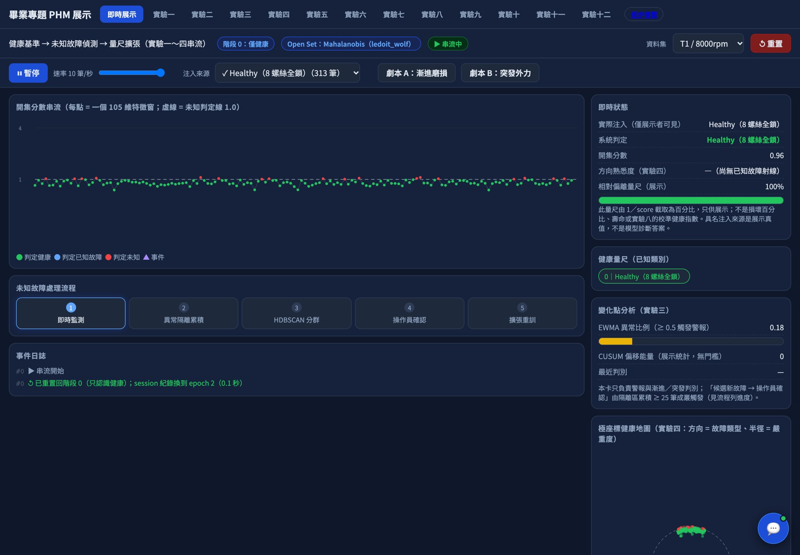
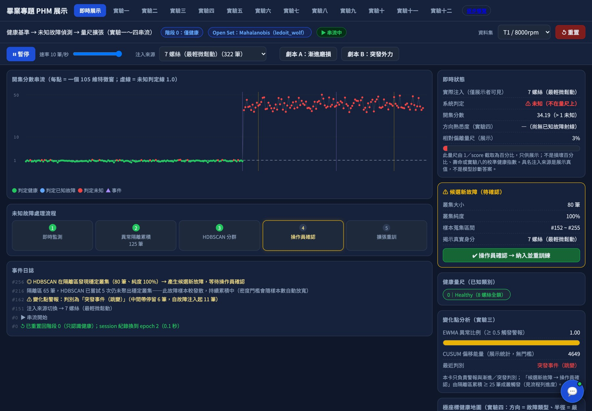
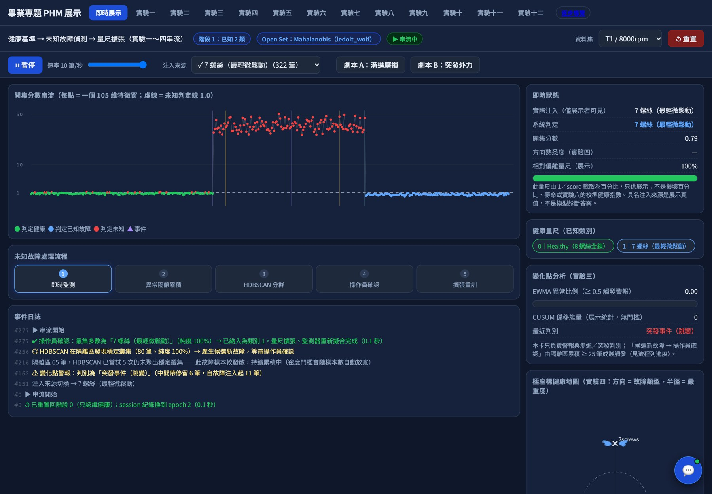
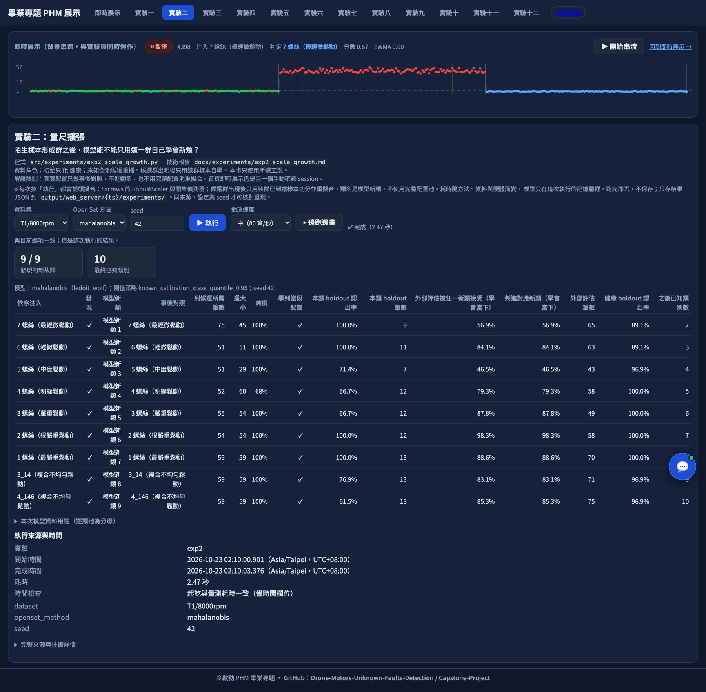

# 畢業專題報告

本檔是書面報告骨架，章節順序與小節依 [專題研究報告格式規範](../Spec/專題研究報告格式規範.md)。各節末行的追蹤連結是編輯標記，排進 Word 時刪除。

正式 Word：章名置中，節名靠左，編號與名稱中間空一格。誌謝至表目錄用小寫羅馬數字；本文起用阿拉伯數字。封面不編頁碼。

總覽：[#149](https://github.com/Drone-Motors-Unknown-Faults-Detection/Lineage/issues/149)。書面排版：[#148](https://github.com/Drone-Motors-Unknown-Faults-Detection/Lineage/issues/148)。

## 封面

封面由上到下為學校與系所、題目、指導教授、學生、日期。正式 Word 全部置中、單行間距。

### 學校、系所與報告類型

逢甲大學

資訊工程學系

專題研究報告

> Word 這三行用 32 點、單行間距、置中，與前段距離 3 點。

追蹤：[#102](https://github.com/Drone-Motors-Unknown-Faults-Detection/Lineage/issues/102)

### 專題題目

Deep learning based approaches for drone motors unknown faults detection.

> Word 用 24 點粗體、單行間距、置中。

追蹤：[#103](https://github.com/Drone-Motors-Unknown-Faults-Detection/Lineage/issues/103)

### 指導教授

指導教授：劉明機 博士、張淵仁 博士

> Word 用 22 點、單行間距、置中。

追蹤：[#104](https://github.com/Drone-Motors-Unknown-Faults-Detection/Lineage/issues/104)

### 學生

學生：王建葦 D1210799

　　　陳稚翔 D1249623

> 每位學生一行，寫出姓名與學號。
> 第一位學生置中；第二位起與第一位學生的姓名對齊。
> Word 用 22 點、單行間距。

追蹤：[#105](https://github.com/Drone-Motors-Unknown-Faults-Detection/Lineage/issues/105)

### 日期

中華民國一百一十五年十月

> Word 用 20 點、單行間距、置中。

追蹤：[#106](https://github.com/Drone-Motors-Unknown-Faults-Detection/Lineage/issues/106)

## 誌謝

這份專題能走到書面報告，要先感謝兩位指導教授。劉明機老師與張淵仁老師在題目方向、實驗設計與結果解讀上給了我們許多指導；張淵仁老師也是原始研究的指導教授，讓我們能接上學長的資料與程式，從既有成果往下做。

感謝沈品志學長。學長的碩士研究《利用深度學習輔助式學習替診斷無人機馬達未知故障檢測》留下了三顆馬達、三種轉速、十種螺絲配置的量測資料，以及從原始訊號切窗到 105 維特徵的整條處理程式。本專題的每一次實驗都讀這批特徵；沒有這份基礎，我們連第一個健康基準都建不起來。學長的 CNN 分類、HDBSCAN 分群與馬氏距離未知偵測流程，也是我們改成「只用健康資料起步」時最直接的對照。

感謝逢甲大學資訊工程學系提供專題修課與發表的機會，也感謝原始研究所屬的航太與系統工程學系，這批馬達量測資料是在那裡完成採集。

最後感謝彼此。兩個人分工寫程式、跑實驗矩陣、核對輸出檔與撰寫文件，遇到結果不如預期時，先回頭查資料切分與程式，再決定要開 issue 還是改方法。這個過程讓我們學到，一個研究結論要能指回程式碼與保存的輸出，才算站得住。

> 篇幅以一頁為原則。Word 頁碼納入誌謝至表目錄的小寫羅馬數字。

追蹤：[#107](https://github.com/Drone-Motors-Unknown-Faults-Detection/Lineage/issues/107)

## 摘要

摘要是全文縮影。最後的關鍵詞使用粗體並縮排。

### 內容概括

預測與健康管理（Prognostics and Health Management，PHM）系統要靠故障資料訓練診斷模型，但設備剛導入時還是新的，通常只拿得到健康運轉的資料，很難事先收齊每一種故障；在收集資料的這段期間，PHM 系統幾乎發揮不了作用。一般分類器只會從學過的選項裡挑答案，看到沒見過的訊號也會硬套進舊類別。本專題把順序反過來，研究的是：只有健康資料時，監測系統能不能先標出「這筆不在已知範圍內」，再把反覆出現的陌生訊號整理成候選群，讓模型把它學成新的已知類別。

資料沿用前人碩士研究的無人機馬達量測：T1、T2、T3 三顆馬達，各在 6000、8000、11000 rpm 下運轉，螺絲配置以 8 顆鎖滿為健康，另有九種非健康配置。每個時間窗由電流、三軸振動與溫差五個通道算出 105 維特徵。

判斷流程分五步。第一步用健康樣本估計特徵分布，以 Ledoit–Wolf 收縮法穩定共變異數，計算每筆樣本到健康分布的馬氏距離。第二步用另一份沒參與擬合的健康校準資料，取距離的 95% 分位數當門檻，把距離除以門檻得到正規化分數，大於 1 就判為未知。第三步把分數明顯偏高的樣本放進隔離區，累積到一定數量後以 HDBSCAN 密度分群找出候選群。第四步把候選群納入成新類別，這一步有兩條路徑：實驗二的批次流程先檢查這群是否比已知資料更遠，太近就退回；否則直接用群內樣本自學，新類別命名為 discovered-N，學會後把已被新類接受的殘餘清出隔離區，整個過程不讀真實配置標籤，也不讀該配置其餘的資料；網頁首頁展示與導覽則保留人員確認，按下確認才揭示配置，並讀取該配置的完整資料池。第五步把所有已知類別重新擬合。故障配置在納入之前只拿來測試，不參與擬合，也不參與門檻設定。

實證部分在同一工況、跨轉速與跨馬達三種條件下評估這條流程，並與 k 近鄰距離、孤立森林、單類支援向量機、自編碼器等偵測器，以及原始論文的深度學習流程對照。系統另做成網頁原型，以既有特徵窗逐筆回放，展示拒絕、分群、確認與更新的過程。

> 數字來源：資料描述見 `docs/畢業專題總手冊.md` 第 4.1、4.2 節；流程見第 7 章，兩條納入路徑以 `src/experiments/exp2_scale_growth.py` 的 `adopt()`／`confirm()` 為準；對照方法見第 8.9、8.11、8.15、8.18 節。

追蹤：[#108](https://github.com/Drone-Motors-Unknown-Faults-Detection/Lineage/issues/108)

### 研究重點與主要貢獻

本專題要回答三個問題：只學健康的模型，能不能拒絕沒學過的配置？陌生樣本累積成群後，模型能不能只靠這群樣本學會新類別？換一個轉速或換一顆馬達之後，原本的健康基準還能不能用？

在同一工況下，答案是可以。九個工況、三個隨機種子的正式矩陣中，Ledoit–Wolf 馬氏距離的健康接受率平均為 94.62%，九種非健康配置全部被拒絕；k 近鄰距離的結果幾乎相同，兩者分不出優劣。新類自學學得到，但學會不等於之後都認得。以 T1／8000 rpm 依序注入九種配置，三個隨機種子都是九段各學到當段注入的配置，沒有同一配置被學成兩類，每種配置在 51 至 118 筆回放樣本內被發現。每種配置另外保留兩成資料不參與回放，學會後拿來檢查：27 組中有 21 組被認得的比例在八成以上，最低只有 53.85%。這個結果依賴自適應密度分群；關掉它，九段只剩兩到三段學到當段配置。

換了工況，答案就變了。把某個工況的健康門檻直接套到其他八個工況，72 組跨工況組合的健康接受率全部是 0，健康樣本也被當成陌生訊號。改成 T1 擬合、T2 校準、T3 測試之後，健康誤報降到 0.23%，未知召回卻只剩 59.10%。同工況的高分不能代表換一顆馬達後仍然有效。

主要貢獻落在四個步驟：

1. **資料角色**：擬合、校準、測試、確認後更新各用哪一份資料，事先寫死；未知配置在確認前不進入擬合與門檻設定。
2. **拒絕與納入流程**：把逐筆拒絕、高分隔離、密度分群、新類納入與重新擬合接成一條可執行、可在網頁回放的流程；批次實驗只用群內樣本自學，網頁展示另保留人員確認的路徑。
3. **對照實驗**：在相同資料角色與相同門檻規則下，比較多種只用健康資料的偵測器，並與原始論文流程對照。
4. **限制揭露**：明寫自學的新類仍可能混入其他配置、學會後部分配置的外部樣本仍認不出來、結果依賴密度分群參數；網頁的人員確認路徑會讀取該配置的完整資料池，屬於有利條件；跨馬達結果偏低；沒有實體壽命資料，配置標籤也不能改寫成物理病因。

105 維特徵與量測資料沿用沈品志的碩士研究《利用深度學習輔助式學習替診斷無人機馬達未知故障檢測》（逢甲大學航太與系統工程學系，2025）[1](#ref-1)。馬氏距離（Mahalanobis, 1936）[2](#ref-2)、Ledoit–Wolf 收縮估計（Ledoit & Wolf, 2004）[3](#ref-3)與 HDBSCAN（Campello, Moulavi & Sander, 2013）[4](#ref-4)都是公開方法。本專題改動的是這些方法在流程中的位置，以及各步驟使用哪份資料。

> 數字來源：`docs/畢業專題總手冊.md` 第 2.3 節（貢獻界線）、第 8.5 節與 `reports/JW-Albert_20261023_exp2_adopt_fix_aero/README.md`（實驗二修正版，Aero 三個 seed：`output/exp2_scale_growth/2026-10-23-00-13-53`、`00-14-18`、`00-14-40`）、第 8.8 節（實驗五）、第 8.9 節（實驗六正式矩陣）、第 8.18 節（P1 跨馬達）。

追蹤：[#109](https://github.com/Drone-Motors-Unknown-Faults-Detection/Lineage/issues/109)

### 關鍵詞

　　**關鍵詞: 預測與健康管理（PHM）、開放集辨識、未知故障偵測、無人機馬達、馬氏距離、HDBSCAN、持續學習**

> Word 這一行整行粗體，首行縮排兩字。

追蹤：[#110](https://github.com/Drone-Motors-Unknown-Faults-Detection/Lineage/issues/110)

## 目錄

（待 Word 依標題樣式自動產生，並標頁次）

- 各章節標題按出現順序列出，並標頁次。
- 正式目錄在 Word 以標題 1、標題 2 自動產生。
- 第一章之前插入「自下頁起」的分節符號，使前置頁與本文分開編頁。
- 內文修改後以 F9 更新目錄，並重新設定字元格式。

追蹤：[#111](https://github.com/Drone-Motors-Unknown-Faults-Detection/Lineage/issues/111)

## 圖目錄

（待正文圖完成後彙整）

- 按圖在正文出現的順序列出圖名與頁次。
- 編號按章區分，例如圖1.1、圖2.3。
- 正文圖名放在圖的下方，置中對齊。
- 圖檔使用 gif 或 jpg。

追蹤：[#112](https://github.com/Drone-Motors-Unknown-Faults-Detection/Lineage/issues/112)

## 表目錄

（待正文表完成後彙整）

- 按表在正文出現的順序列出表名與頁次。
- 編號按章區分，例如表1.1、表2.3。
- 正文表名放在表的上方，靠左對齊。
- 表格跨頁時，標題列在每頁頂端重複。

追蹤：[#113](https://github.com/Drone-Motors-Unknown-Faults-Detection/Lineage/issues/113)

## 第一章 緒論

章名置中，節名靠左，編號與名稱中間空一格。緒論引導讀者進入問題。

### 1.1 研究背景

預測與健康管理（Prognostics and Health Management，PHM）把設備維護拆成幾個層次：先監測設備狀態，再診斷出了什麼問題，最後預估還能用多久 [5](#ref-5)、[6](#ref-6)。每一層都要靠資料。診斷層通常是一個分類模型：給它一段振動或電流訊號，它回答這是哪一種狀態。這類模型要先看過每一種故障的樣本，才學得會辨認。

問題出在設備剛導入的時候。新馬達裝上無人機，能收到的幾乎都是健康運轉的資料；螺絲鬆脫、軸承磨損這些故障，要等它真的發生才收得到樣本，也不可能事先把每一種故障、每一種嚴重程度、每一個轉速都做一遍。於是 PHM 系統在最需要建立信任的初期，手上只有健康資料，診斷模型訓練不起來。這段期間監測系統要回答的問題，比「這是哪一種故障」更基本：這筆訊號還在健康範圍內嗎？如果不在，它和之前看過的異常是不是同一種？

這個問題值得處理，因為兩種錯誤的代價都高。把沒見過的故障硬判成健康或某個已知故障，維護人員會被誤導；反過來，每一筆偏離都發警報，現場很快就不再理會警報。無人機馬達還多一層風險：螺絲鬆動會隨飛行時間惡化，等到收齊故障樣本再部署模型，可能已經錯過處理時機。

目前處理這類問題的研究大致有三條路：

1. **監督式故障分類**：以卷積神經網路等模型直接學各類故障，在已知類別上準確率高，但它是封閉集合的考卷，只學過健康與配置甲、乙，看到配置丙仍會從甲、乙裡挑一個，沒有「這題不在我會的範圍」這個出口。本專題承接的原始論文 [1](#ref-1) 就是以 CNN、ResNet 類與 VGG 類模型學健康加四種已知配置，再取中間層特徵做後續判斷。
2. **單類監測與新奇偵測**：只用正常資料描述正常範圍，例如馬氏距離與馬氏–田口法 [7](#ref-7)、單類支援向量機 [8](#ref-8)、支援向量資料描述 [9](#ref-9)，綜述見 [10](#ref-10)。它們不需要故障樣本，能回答「是否異常」，但只能說「不正常」，說不出這次異常和上次是不是同一種，也不會把新出現的異常變成可辨認的類別。
3. **開集辨識**：在分類器外加上拒絕機制，對離已知類別太遠的樣本回答「未知」[11](#ref-11)、[12](#ref-12)、[13](#ref-13)。它補上了監督式分類缺的出口，但多數方法假設一開始已經有好幾個已知類別可以訓練，未知樣本被拒絕之後，也沒有規定接下來要怎麼處理。

原始論文已經把開集的想法用在同一批無人機馬達資料上：先訓練五類分類網路，再用 HDBSCAN 分群與馬氏距離判讀測試批次，最後把十種配置重新訓練成十類。它的起點是五個已知類別，門檻取自訓練資料自身的距離，判斷以整個測試群的中心為單位。

本專題把起點往前推到「只認識健康」，並把判斷單位改成逐筆。與上述做法相比，差別落在三個步驟：門檻用另一份沒參與擬合的健康校準資料來定，不用訓練資料自己的距離；每一筆到達的特徵窗各自判斷接受或拒絕，不等湊成測試群；被拒絕的高分樣本進入隔離區，累積成密集群後才成為候選新類別，納入之後重新擬合，模型認得的範圍隨著運轉逐步擴大。故障配置在納入之前只用來測試，不參與擬合與門檻設定。這些步驟的效果與限制，留到第四章用實驗回答。

追蹤：[#114](https://github.com/Drone-Motors-Unknown-Faults-Detection/Lineage/issues/114)

### 1.2 研究動機

PHM 系統導入時有一個先有雞還是先有蛋的困境：診斷模型要故障資料才能訓練，而設備在導入初期是新的，不會故障。照一般流程，系統得先收集資料，等故障樣本夠了再訓練診斷模型；收集期間系統幫不上忙，偏偏這段期間也最需要讓使用者相信它。

原始論文證明了這批馬達資料在已知五類的條件下可以分類，也示範了用分群與距離找出未知。我們想往前問一步：如果一開始只認識健康，系統能不能從第一天就開始工作？能工作的話，它能做到哪一步，又在哪裡會失敗？

這個問題有兩個實際的理由值得做。第一，健康資料最容易取得，只要設備在運轉就有；如果只靠健康資料就能先判斷「正常」與「不正常」，PHM 系統從導入當天就能使用。第二，故障是陸續出現的，每次出現一種新的異常，都重新收集完整資料、重新訓練一次模型，成本很高；如果系統能把反覆出現的陌生訊號自己整理成群，再把這群加進已知範圍，能力就能跟著運轉時間累積。

這兩個理由也帶出要誠實面對的風險。只用健康資料定出的範圍，換一個轉速或換一顆馬達可能就不準；把一群陌生樣本學成新類別，也可能學到混雜的樣本。所以本專題除了把流程做出來，也把它放到不同工況、不同馬達與其他方法的對照下檢查，並在第四章與第五章交代哪些情況可行、哪些情況失敗。

追蹤：[#115](https://github.com/Drone-Motors-Unknown-Faults-Detection/Lineage/issues/115)

### 1.3 研究目的

本專題要回答以下五個問題，每一項在第四章都有對應的實驗：

1. **只用健康資料，能不能拒絕沒學過的配置？** 在同一顆馬達、同一個轉速下，只以健康配置 `8screws` 建立基準，檢查九種非健康配置會不會被判為未知，以及健康樣本被誤報的比例。對應實驗一（冷啟動）、實驗六（九工況正式矩陣）與實驗十二（混淆矩陣）。
2. **陌生樣本累積成群後，能不能變成新的已知類別？** 依序注入九種配置，檢查候選群是否形成、學到的是不是當段注入的配置、學會之後外部樣本認不認得，以及健康辨識有沒有退步。實驗二的批次流程只用群內樣本自學；網頁展示另保留人員確認後讀取完整資料的路徑，兩條路徑分開評估。對應實驗二。
3. **異常是漸進出現還是突然發生，能不能從分數序列分辨？** 以安排好的漸進與突發劇本回放，檢查警報時點與判別結果。對應實驗三，另以實驗四（極座標方向與半徑）與實驗八（相對健康指數）檢查分數能否提供方向與程度的參考。
4. **一個工況的健康基準，換了轉速或換了馬達還能不能用？** 把某個工況的門檻直接套到其他工況，再比較混合訓練、少量目標資料遷移等做法；另以一顆馬達擬合、另一顆校準、第三顆測試，檢查跨馬達的表現。對應實驗五（跨工況）、實驗十（遷移）與總手冊第 8.18 節的跨馬達研究。
5. **主方法和其他做法相比如何？** 在相同的資料角色與門檻規則下，比較馬氏距離、k 近鄰距離、孤立森林、單類支援向量機、自編碼器等只用健康資料的偵測器，並在原始論文的五類協定下對照原始方法。對應實驗六、實驗七、實驗九與實驗十一。

追蹤：[#116](https://github.com/Drone-Motors-Unknown-Faults-Detection/Lineage/issues/116)

### 1.4 研究範圍

**資料。** 本專題使用原始論文採集並處理的無人機馬達資料，不重新採集、不修改。資料包含 T1、T2、T3 三顆不同的馬達，每顆在 6000、8000、11000 rpm 三個轉速下運轉，共九個工況。每個工況有十種螺絲配置：`8screws` 是八顆螺絲鎖滿的健康配置；另外九種是非健康配置，包含 `1screw`（或 `1screws`）至 `7screws` 的均勻減少，以及 `3_14screws`、`4_146screws` 兩種依位置命名的配置。

**特徵。** 每筆樣本是一個時間窗，由電流、三軸振動與溫差五個通道計算而成。名目取樣率 10000 Hz、每窗 10000 點。每個通道各取 15 個統計量（例如均方根、峰度、峰對峰值），三軸振動另取 1 到 10 倍旋轉頻率附近的頻譜峰值，合計 105 維。本專題直接讀取原始論文管線產出的 105 維特徵，不改特徵定義，也不增減維度。

**系統型態。** 本專題完成的是研究原型：把已存好的特徵窗依序回放，模擬逐筆到達的串流，在離線批次與網頁介面上展示判斷、分群與更新。網頁上每秒送出幾筆是播放節奏，不是實際的感測採樣時鐘；漸進與突發的劇本由實驗安排，不是真實的劣化過程。

**不包含的範圍。**

- 實體壽命試驗與剩餘壽命預估：三顆馬達是不同個體，資料裡沒有同一顆馬達從新到壞的連續紀錄與失效終點，因此不做剩餘壽命預估。
- 接入飛行控制或安全接管：系統只輸出判斷與警報，不控制無人機，也沒有在飛行中驗證。
- 把配置標籤改寫成物理病因：資料以螺絲數量與位置命名，本專題稱之為「非健康配置」，不把它們說成軸承、繞組等九種不同的故障原因；「未知」也只表示超出目前已知的範圍，不代表一定危險。

追蹤：[#117](https://github.com/Drone-Motors-Unknown-Faults-Detection/Lineage/issues/117)

### 1.5 研究方法

本專題的主路線由六個步驟組成，細節留到第三章：

1. **健康分布距離。** 用健康樣本估計 105 維特徵的分布，以 Ledoit–Wolf 收縮法估計共變異數 [3](#ref-3)，讓樣本數不多時仍能穩定計算每筆樣本到健康分布的馬氏距離。
2. **校準門檻。** 健康資料切成擬合、校準、保留三份。用沒參與擬合的校準資料取距離的 95% 分位數當門檻，距離除以門檻就是正規化分數，大於 1 判為未知。
3. **逐筆拒絕。** 每一筆特徵窗到達時就計算分數並判斷，不等湊成一批。
4. **高分樣本分群。** 分數明顯超線（大於 2）的樣本才進入隔離區；隔離區累積到一定數量後，以 HDBSCAN 密度分群 [4](#ref-4) 找出夠大、夠密集的候選群。只略為超線的樣本只發警報，不參與分群，以免健康誤報自己聚成假候選。
5. **確認或自學。** 候選群要成為新類別有兩條路徑。網頁首頁展示與導覽保留人員確認：按下確認才揭示真實配置，並讀取該配置的資料。實驗二的批次流程不等人員確認：群若沒有比已知類別的校準資料更遠就退回，否則直接用群內樣本自學，類別命名為 `discovered-N`，真實配置只放在事後對照。
6. **重新擬合。** 新類別加入後，所有已知類別一起重新擬合與校準，模型認得的範圍因此擴大，接著繼續監測。

整個過程中，故障配置在納入之前只用來測試，不參與擬合與門檻設定。主路線之外，本專題另以 k 近鄰距離、孤立森林等偵測器作對照，並以 EWMA 平滑的未知比例分辨漸進與突發，這些都在各自成立的條件下使用，不取代主路線。

追蹤：[#118](https://github.com/Drone-Motors-Unknown-Faults-Detection/Lineage/issues/118)

### 1.6 研究流程

研究流程如圖1.1，從上到下依序是：

1. 讀入健康配置的特徵窗，擬合縮放器與健康分布。
2. 以健康校準資料定出門檻。
3. 新的特徵窗逐筆到達，計算正規化分數。分數不大於 1，判為已知類別並繼續監測。
4. 分數大於 1 判為未知。只略為超線（不大於 2）的樣本只發警報；明顯超線的樣本進入隔離區。
5. 隔離區每累積 10 筆新樣本就試一次 HDBSCAN 分群；沒有找到至少 25 筆的群，就繼續累積。
6. 找到合格的群就成為候選。實驗二批次流程先檢查這群是否比已知類別的校準資料更遠，沒有更遠就退回，否則用群內樣本自學；網頁展示由人員確認，若這群其實是已知類別的邊界樣本就退回，若是新配置則讀取該配置的完整資料。
7. 新類別加入後，所有已知類別一起重新擬合，量尺擴大；實驗二另把隔離區中已被新模型接受的殘餘移出。之後回到第 3 步繼續監測。

每一筆的未知旗標（判為未知記 1，否則記 0）同時送進趨勢分支：以 EWMA 平滑成未知比例，比例越過警報線時，依它先前在中間帶停留的時間判斷異常是漸進還是突發。


圖1.1 研究流程

> 圖名在 Word 置中。原始檔：`figures/src/fig1-1_研究流程.mmd`。實驗二批次走 `adopt()`，首頁展示與導覽走 `confirm()`，兩條路徑見 `src/experiments/exp2_scale_growth.py`。

追蹤：[#119](https://github.com/Drone-Motors-Unknown-Faults-Detection/Lineage/issues/119)

### 1.7 章節結構

（待撰）

- 依實際五章與附錄說明各章在做什麼。
- 標題用字與目錄一致。

追蹤：[#120](https://github.com/Drone-Motors-Unknown-Faults-Detection/Lineage/issues/120)

## 第二章 相關文獻回顧

回顧相關方法並提出比較對象。選材以學術價值足夠、且與主題、架構或方法有關者為限。

### 2.1 研究形成的背景資料

PHM 的文獻把設備維護拆成資料擷取、狀態監測、診斷與預後幾個環節，其中診斷與預後都假設手上已有足夠的故障或劣化資料 [5](#ref-5)、[6](#ref-6)。Jardine 等人回顧條件式維護時，把流程分成資料擷取、資料處理與維護決策三步，並分別整理診斷與預後所用的統計、人工智慧與模型式方法；Lee 等人針對旋轉機械整理 PHM 的設計方法與應用。兩篇綜述描述的診斷模型，都要先收集到各種狀態的標記資料才建得起來。

設備剛導入時，這個前提通常不成立。新馬達只會產生健康運轉的資料，故障樣本要等事件發生才收得到。這種「只有正常資料」的情境，在文獻中稱為單類分類或新奇偵測（novelty detection）。Pimentel 等人的綜述把新奇偵測定義為：以正常資料建立模型，再找出測試資料中與訓練分布不同的樣本，並把方法分成機率式、距離式、重建式、領域式與資訊理論式五類 [10](#ref-10)。本專題用到的方法分屬其中幾類：馬氏距離以健康資料的中心與共變異數衡量偏離，馬氏–田口法以健康群的馬氏距離建立參考空間來判斷異常 [7](#ref-7)；單類支援向量機以核函數估計正常資料的支持區域 [8](#ref-8)；支援向量資料描述以最小超球包住目標資料 [9](#ref-9)；PCA 與自編碼器以重建誤差衡量偏離。這些方法讓系統在沒有故障樣本時，就能回答「這筆資料是否偏離健康」。

單類方法只有「正常」與「不正常」兩種輸出。系統認識幾種故障之後，問題變成多類別辨識加上拒絕：已知類別要分對，沒學過的類別要能回答「不知道」。一般分類器採封閉集合假設，認定每筆測試樣本都屬於訓練時見過的某一類，因此沒有拒絕出口。Scheirer 等人把這個問題形式化為開集辨識（open set recognition），指出分類器若在遠離已知樣本的空間仍給出已知類別標籤，就會產生開放空間風險，評估時必須同時看已知類別辨識與未知拒絕 [11](#ref-11)。後續研究把拒絕機制接到深度網路上：Bendale 與 Boult 以 OpenMax 改寫 softmax 層，讓網路多輸出一個「未知」的機率 [12](#ref-12)；K. Lee 等人在深度特徵上為每個類別估計一個高斯分布，以樣本到最近類別的馬氏距離作為分布外分數 [13](#ref-13)。逐類高斯分布加馬氏距離的拒絕方式，就是本專題在 105 維特徵上採用的結構。

開集辨識只處理到拒絕。被拒絕的樣本接下來怎麼辦，Bendale 與 Boult 在開放世界辨識（open world recognition）的框架中拆成三步：偵測未知、標記未知、把新類別增量加入模型 [14](#ref-14)。這個框架與本專題要走的路線一致，但原文以影像分類為例，起點已有多個已知類別，也沒有規定未知樣本在串流中如何累積成可標記的群。

把這些研究放回無人機馬達的情境，問題的形成可以整理成四點。PHM 的診斷模型需要故障資料，導入初期拿不到。單類監測不需要故障資料就能發出異常警報，但不會長出新的類別。開集辨識提供拒絕出口，但通常假設一開始已有多個已知類別。開放世界辨識談到拒絕之後的標記與更新，但沒有交代更新用的資料從哪裡來。沈品志的碩士研究在同一批馬達資料上，以健康加四種配置共五類訓練分類網路，再以 HDBSCAN 與馬氏距離判斷測試批次是否未知 [1](#ref-1)，說明這批 105 維特徵足以支撐未知判斷。本專題接著問：把起點退到只有健康配置，逐筆拒絕、累積成群、再把群納入成新類別，這條路能走到哪裡。

追蹤：[#121](https://github.com/Drone-Motors-Unknown-Faults-Detection/Lineage/issues/121)

### 2.2 與研究主題有關的論文

沈品志於 2025 年的碩士論文研究無人機馬達的深度分類、遷移學習與未知故障檢測 [1](#ref-1)。現有 Markdown 轉錄的第三篇與第四篇，分別介紹 CNN_11 Layers、CNN_Res、CNN_VGG 的已知五類分類，以及特徵、HDBSCAN、馬氏距離與閾值的未知檢測流程。因此原作已包含未知偵測，不能只用閉集分類描述它。轉錄中的「95% 信賴區間」及群組分析，也不能直接視為本專題以獨立 calibration 分位數判定逐筆未知的同一協定。

本專題承接原作的馬達資料、105 維特徵與方法問題，將健康起步、逐筆拒絕、隔離候選與模型更新做成共用的 CLI／Web 流程。比較時須核對已知類別、輸入表示、校準來源與測試分母；本報告第 4.2.1 節的 legacy 對照另有負標籤介面混雜，不能據該結果宣稱原論文方法失效。原作目前可查的是固定版本程式與 Markdown 轉錄，尚未與原始 PDF 校訂；轉錄的錯字、頁碼及不完整參考表不作精確引文或未核實作者映射的依據。

Chen 等人的無人機馬達研究 [15](#ref-15)，以電流訊號的小樣本分類為目標：先由 Broad Learning System（BLS）映射特徵，再交由一維 CNN 分類，以交叉熵訓練。原文第 2.2–2.3 節交代模型，第 3.2 節列出軸承、轉子與定子的人為故障，第 4 節以不同訓練量及三種轉速比較模型並展示測試混淆矩陣。這提供「少量有標籤訊號如何建分類器」的比較方向，該評估沒有直接驗證本專題所要求的保留未知類拒絕與納入後更新。

兩份研究與本案的資料條件不能互換：Chen 等人的物理故障類別不同於本案螺絲數量／位置配置；本案的 105 維窗也不同於其電流切片及 BLS 表示。第四章若比較演算法，必須在本案相同資料角色與輸入條件下重跑；本節不將其他資料集的分類準確率與本案未知召回並排排名，也不宣稱已重現 BLSCNN。

追蹤：[#122](https://github.com/Drone-Motors-Unknown-Faults-Detection/Lineage/issues/122)

### 2.3 與研究架構有關的論文

Tax 與 Duin 的 Support Vector Data Description（SVDD）[9](#ref-9) 描述目標資料的邊界，以較小的球形包絡涵蓋目標樣本，允許部分離群並可透過核函數形成非線性邊界；原文第 2 節說明其最佳化。它與本案健康冷啟動相接之處，是先描述允許的目標區域，再拒絕不符合參考的輸入。本專題沒有實作 SVDD；健康距離監測與實驗六的 One-Class SVM 都不能直接冠上 SVDD 名稱。

Scheirer 等人 [11](#ref-11) 在第 2 節將 open space risk 與已知資料的經驗誤差一起納入開放集問題：遠離已知樣本的空間，不應無限延伸成某個已知類。本文據此將「辨識已知配置」與「拒絕未學配置」分別評估；只列已知分類 accuracy 不足以回答未知檢測。本案以校準後距離保留拒絕出口，沒有實作該文的 1-vs-Set Machine，也沒有量測或證明相同的 open space risk 界。

Bendale 與 Boult [14](#ref-14) 的第 3–4 節進一步將未知偵測、未知資料標記與增量更新列為 open world recognition 的不同步驟，並提出 Nearest Non-Outlier（NNO）。這提供本案「拒絕後還要累積、確認／納入，才成為已知類」的架構比較。NNO 的距離函數、增量效率與風險條件沒有在本案重現，引用其架構不構成本站的可靠性保證。

現行程式有兩條不同的納入路徑。[實驗二](../../src/experiments/exp2_scale_growth.py)批次與實驗頁呼叫 `ScaleGrowthSession.adopt()`：候選群的中位分數不超過已知 calibration 列的最大分數時，回傳 `rejected_boundary` 並清除該群；通過這項檢查且群至少五筆時，只將該群到達樣本交給 `add_observed()`，以 `discovered-N` 建新類。重擬合後，隔離區中已被任一已知類接受的殘餘會移出。這些決定不讀真值；群的真值多數與純度只供事後對照，候選仍可能混入不同配置。首頁與獨立導覽呼叫 `confirm()`，確認後按配置名稱讀取完整標記池，再重新擬合；這是有真值與完整池的模擬確認。兩者都與 open world 的更新問題相關，但前者的成群不能證明物理病因，後者也不能當成只學已到達樣本的現場線上學習。

實驗二為每個未知配置保留 20% 外部評估列（向上取整，亂數來源為 `seed+2`），重播不抽這些列。`final_eval` 的 `known_rate` 表示被任一新類接受的比例，沒有要求判成該配置對應的特定類；群內 `own_holdout_acc` 也不能代替這份外部評估。這種同池分列沒有建立新的獨立採集或未見馬達測試。第四章須分開呈現未知拒絕、候選品質、更新資料量與更新後辨識，不以一個成功率代替整條流程。

追蹤：[#123](https://github.com/Drone-Motors-Unknown-Faults-Detection/Lineage/issues/123)

### 2.4 與研究方法有關的論文

#### 2.4.1 馬氏距離與共變異數估計

Mahalanobis 的距離概念 [2](#ref-2) 以共變異數描述不同方向的變動尺度，讓高度相關的特徵不被當成互不相關的證據。本站實作計算樣本偏離類中心的二次型再開根號。Ledoit 與 Wolf [3](#ref-3) 在原文第 2–3 節研究高維共變異數的收縮：把樣本共變異數與等變異、零相關的結構目標混合，以估計誤差決定權重，改善有限樣本下的條件數。LW 仍是馬氏距離內的共變異數估計器，沒有取代距離定義；共變異數估計誤差的理論目標也不等於馬達未知召回的保證。

Chen、Wiesel、Eldar 與 Hero 的 OAS [16](#ref-16) 在 Gaussian 樣本假設下近似最小均方誤差的 oracle 收縮係數；原文第 III 節區分 RBLW 與 OAS。本案用 scikit-learn 的 `OAS`，其 1.7 文件明記 Eq. (23) 的 `2/p` 小項未沿用 [17](#ref-17)，不能聲稱逐式重現原文。Rousseeuw 與 Van Driessen 的 FastMCD [18](#ref-18) 則加速尋找共變異數行列式小的 h 筆子集，用於穩健位置與散布估計；1999 年是這個演算法的來源，MCD 概念更早。本站的 `mcd` 選項先在 known train 做 PCA，再逐類 `MinCovDet`，因此同時改了表示與估計器；不能把結果全部歸因於穩健估計。

在 [core.mahalanobis](../../src/core/mahalanobis.py) 與 [core.openset](../../src/core/openset.py)，LW／OAS／MCD 的每個已知類別各有 train 分布與 known calibration 門檻，整體分數取 `min_c(distance_c / threshold_c)`，嚴格大於 1 才拒絕。`confidence=0.95` 是校準距離分位數，不是某筆預測有 95% 正確機率。legacy 另合併全部已知類，用訓練自身距離定線。因此逐類、獨立校準與收縮是不同設計，整套流程比較不能冒稱 LW 的單因子效果。距離、收縮、校準與正規化符號見[第 3.2 節](#32-理論基礎)；[附錄 二](#附錄-二-公式)的公式彙整仍待撰。

#### 2.4.2 密度分群與候選發現

Campello、Moulavi 與 Sander [4](#ref-4) 的 HDBSCAN 方法從密度層級建立簡化群樹，再按群的穩定程度選擇群，允許不同密度尺度與噪聲；McInnes、Healy 與 Astels [19](#ref-19) 的 2017 年 JOSS 文是 Python 軟體來源，不能當成方法首次提出年份。本案在實驗二先拒絕分數高的窗，再對隔離區做 `fit_predict()`，找符合最小筆數的候選，沒有讓 HDBSCAN 直接取代健康異常偵測器。群的真值多數不參與幾何分群，但程式會計算它供對照或模擬確認；不能把延後顯示真值說成後端完全沒有真值。成群只能支持特徵相似，仍不能證明故障原因。

本案的偵測線 1.0、隔離線 2.0、每十筆新未知樣本重試、候選至少 25 筆，以及隔離區達 75／100 筆時加試較低密度參數，都是專案設定，不是原論文對馬達資料給出的參數保證。密度階梯可能提早成群，也可能形成混合配置群；關閉階梯的比較須保持相同資料與 seed，分開檢查延遲及純度，不能只以延遲較短判定較可靠。

#### 2.4.3 逐類近鄰距離拒絕

Cover 與 Hart [20](#ref-20) 研究由最近已標記樣本決定類別的 nearest-neighbor 分類，並在其抽樣與漸近條件下分析誤差界。本站 `KNNOpenSetDetector` 保留每類 train 參考，計算 k 個近鄰的平均歐氏距離，再除該類 known-cal 分位數；預設 k=5，類內 train 較少時取有效 k。此處的距離拒絕與獨立校準是專案的工程組合，不能把原文分類誤差界套成此高維、跨馬達資料的未知拒絕保證。它和馬氏方法共用縮放、資料角色及分數方向，可在實驗七配對比較，不因避免共變異數求逆就預設較準。

#### 2.4.4 重建誤差與其他對照

Pearson 的幾何擬合文 [21](#ref-21) 是主成分方法的重要來源。本站 PCA reconstruction 在健康 train 擬合線性子空間，以新窗還原後的 L2 誤差作異常分數；保留 95% train 變異不等於 95% 故障分類準確率。Hinton 與 Salakhutdinov [22](#ref-22) 研究以瓶頸編碼、解碼及預訓練建立非線性低維表示，是 AutoEncoder 的代表文獻，不能稱它是 AE 最初發明。

本站 [MLPAutoencoderDet](../../src/core/detectors.py) 用 `MLPRegressor(X, X)`，隱藏層 64／16／64、ReLU、最多 2,000 輪及 early stopping，沒有使用原文的 RBM 逐層預訓練。套件 1.7 的內部 validation 預設取 train 的 10%，以 R² 早停 [23](#ref-23)；外層 healthy calibration 才定重建誤差門檻，兩種用途須分開。未知也可能重建得好，故重建損失較小不直接證明未知分離較佳。

實驗六實際的八個對照為 LW、legacy、One-Class SVM、Isolation Forest、LOF、k-NN 距離、PCA 重建與 MLP AutoEncoder。`core.detectors.ALL_DETECTORS` 的 healthy-only wrapper 共用健康 train 的 RobustScaler 與校準分位數；legacy 門檻取 train 是明示例外。One-Class SVM 看支持邊界，Isolation Forest 看隨機隔離分數，LOF 看相對鄰居的局部稀疏程度；它們不等於一般多類更新 factory，也不等於 SVDD。第四章須按各實驗相同角色與分母比較，不能從模型名稱或引用論文的成績決定本站勝負。

本節取用範圍為原作方法與本案實作的對照：LW、OAS、FastMCD、近鄰與 AE 已核對可取得的方法內容；Mahalanobis 原文與 Pearson 掃描全文未在本輪取得，HDBSCAN 2013 以出版社摘要、書目及作者軟體說明核對。未對這三份原文做逐式校訂，不補造全文閱讀或原作實驗重現的證據。

追蹤：[#124](https://github.com/Drone-Motors-Unknown-Faults-Detection/Lineage/issues/124)

### 2.5 比較對象

第四章的比較分兩層。第一層比較「拒絕」這一步：在只認識健康、或只認識固定幾種配置時，哪一種分數比較能把沒學過的配置分出來。第二層比較本專題的類別角色與原始論文流程的差異。各比較對象的資料條件列在表2.1。除非另外註明，以下前提對所有對象都成立：

1. 資料是單一工況（一顆馬達、一個轉速）的 105 維 clean 特徵，由 `src/core/data.py` 的 `load_pools` 讀入；工況由 `discover_datasets` 掃描，資料齊全時是 T1、T2、T3 各三個轉速共九個。
2. 每個已知類別的資料池由 `make_split` 洗牌後切成 train／cal／holdout：train 取 floor(0.6n) 筆，cal 取 max(1, floor(0.2n)) 筆，其餘為 holdout。
3. `RobustScaler` 與偵測器只用 train 擬合；門檻取 cal 原始分數的 0.95 分位數；正規化分數大於 1 判為未知。
4. 沒學過的配置只當測試資料，不參與擬合、校準或選參數。
5. 不同 seed 只改變列的洗牌順序，同一工況的資料不會因此變成新的採集。

**原始論文流程。** 沈品志的流程以健康加四種配置（`8screws`、`1screw`、`2screws`、`3screws`、`4screws`）為已知五類，訓練 CNN、ResNet 類與 VGG 類網路，取中間層輸出作為深層特徵。依代表性的 Step4 程式，已知深層特徵經 HDBSCAN 取出 inlier 後合併成一個全域分布，以經驗共變異數加小對角 ridge 取偽逆，門檻取訓練資料自身距離的 95% 分位數；測試資料先分群，以群中心是否超過門檻判斷整群是否未知 [1](#ref-1)。本專題沒有重跑原始論文的網路與 notebook。第四章引用它的流程描述，不把它在深層特徵上的準確率與本專題的逐筆結果並排排名。

**實驗十一：原始論文類別角色對照。** `src/experiments/exp11_ancestor_comparison.py` 在 105 維特徵上重建原始論文的類別角色，比較「全域分布、訓練資料自身定門檻」與「逐類 Ledoit–Wolf、獨立校準」。協定 A 以 `8screws` 加 `1screw`（或 `1screws`）、`2screws`、`3screws`、`4screws` 為已知，`5screws`、`6screws`、`7screws`、`3_14screws`、`4_146screws` 為未知；協定 B 只以 `8screws` 為已知，其餘九種為未知。`legacy` 把所有已知類別的 train 合併估一個分布，門檻取 train 自身距離的 0.95 分位數；`ledoit_wolf` 逐類估計，門檻取各類 cal。測試資料是各已知類別的 holdout 加上未知配置的完整資料池，以多類別 accuracy、balanced accuracy 與 macro-F1 評分。seed 為 42、123、2026；九個工況齊全時共 9 × 3 × 2 × 2 = 108 列結果。`legacy` 的唯一分布標記是 −1，而 `OpenSetMonitor.classify` 把負標記當成未知，所以 `legacy` 輸出不了已知類別名稱。第四章比較兩者時，這個介面差異要和共變異數、校準來源的差異一起列出。

**實驗六廣義版：八種只用健康資料的偵測器。** `src/experiments/exp6_osr_benchmark.py` 只以健康為已知，比較 `src/core/detectors.py` 中 `ALL_DETECTORS` 的八種偵測器：逐類 Ledoit–Wolf 馬氏距離、legacy 馬氏距離、單類支援向量機（`nu=0.05`）、孤立森林（200 棵樹）、LOF（20 個鄰居）、5 個鄰居的平均距離、保留 95% 變異的 PCA 重建誤差，以及 MLP 自編碼器。每個工況的健康池切 60／20／20，八種方法共用同一份切分；各方法各自以 train 擬合 `RobustScaler` 與模型，以 cal 的 0.95 分位數正規化（legacy 例外，用 train）。測試資料是健康 holdout 加上其餘九種配置合併的完整資料池。CLI 預設 seed 42，以同一個亂數產生器依序切分所有工況。

**實驗九：非線性自編碼器。** 實驗九就是實驗六廣義版中的 `mlp_autoencoder`，資料角色與實驗六相同，不另外切資料。網路為 105→64→16→64→105，隱藏層用 ReLU，最多訓練 2000 輪；`early_stopping=True` 會再從健康 train 內部切出 10% 當提早停止的驗證資料，只依這 10% 的重建 R² 選權重。外層 cal 仍只用來定重建誤差的門檻。它的直接對照是同一張表裡的 PCA 重建誤差。

**實驗六正式版與矩陣：Ledoit–Wolf 對 k-NN。** `src/experiments/exp6_formal_benchmark.py` 經 `src/core/openset.py` 的同一個工廠建立兩種偵測器：逐類 Ledoit–Wolf 馬氏距離，以及逐類 k-NN 平均歐氏距離（k=5，類內 train 少於 5 筆時取有效 k）。資料角色與實驗六廣義版相同：健康切 60／20／20，九種配置全部只當測試。`src/experiments/exp6_matrix.py` 把它排成九工況 × 三個 seed（42、123、2026）× 兩種方法，共 54 格。第四章比較主方法與另一種距離時，以這組矩陣為主要依據。

**實驗七：單工況配對。** `src/experiments/compare_openset.py` 在一個工況內（CLI 預設 T1／8000 rpm、seed 42），以兩個 `OpenSetMonitor` 分別建立 Ledoit–Wolf 與 k-NN 偵測器。兩者的健康切分完全相同，測試資料也相同（健康 holdout 加九種配置全池）。它與實驗六正式版的差別是走主流程的 `OpenSetMonitor`，並逐配置列出拒絕率與分數中位數。

表2.1 比較對象的資料條件

| 比較對象 | 程式入口 | 擬合用的已知資料 | 門檻來源 | 測試資料 | 工況與 seed |
| --- | --- | --- | --- | --- | --- |
| 原始論文流程 | 原始論文 notebook（未重跑） | 健康＋四種配置的深層特徵，合併成全域分布 | 訓練資料自身距離的 95% 分位數 | 測試批次，以群中心判斷 | 依原論文 |
| 實驗十一 | `exp11_ancestor_comparison.py` | A：8／1／2／3／4screws；B：8screws；各類 train 60% | legacy：train；LW：各類 cal 20% | 各已知類 holdout＋未知配置全池 | 掃描到的工況 × seed 42、123、2026 |
| 實驗六廣義版 | `exp6_osr_benchmark.py` | 8screws 的 train 60% | 各方法 cal 20% 的 0.95 分位數（legacy 用 train） | 健康 holdout＋九種配置全池 | 掃描到的工況，seed 42 |
| 實驗九 | 同上（`mlp_autoencoder`） | 同上；另從 train 內切 10% 作提早停止 | 同上 | 同上 | 同上 |
| 實驗六正式版與矩陣 | `exp6_formal_benchmark.py`、`exp6_matrix.py` | 8screws 的 train 60% | cal 20% 的 0.95 分位數 | 健康 holdout＋九種配置全池 | 九工況 × seed 42、123、2026 |
| 實驗七 | `compare_openset.py` | 8screws 的 train 60% | cal 20% 的 0.95 分位數 | 健康 holdout＋九種配置全池 | 預設 T1／8000 rpm，seed 42 |

讀表時有三點要注意。實驗六廣義版的 `knn_dist` 固定用 5 個鄰居、只看健康一類，和正式版的 `KNNOpenSetDetector` 是不同實作，兩者的數字不混用。實驗六、七、九都是健康對故障的二元判斷，分母是健康 holdout 與故障全池；實驗十一是多類別分類，分母是已知類別 holdout 加未知全池。第四章同一張表只放同一種分母的數字。另外，主方法的發現與更新步驟沒有外部對照，只有實驗二內部的兩組對照：`adopt()` 與 `confirm()` 兩條納入路徑，以及以 `--fixed-density` 關閉密度階梯的消融，兩者都使用與主方法相同的資料條件。

追蹤：[#125](https://github.com/Drone-Motors-Unknown-Faults-Detection/Lineage/issues/125)

## 第三章 論文主體

本章呈現本專題的方法，是全文核心。

### 3.1 研究方法

本專題的主方法是一條從健康基準出發的逐筆監測流程，程式在 `src/core/monitor.py` 的 `OpenSetMonitor` 與 `src/experiments/exp2_scale_growth.py` 的 `ScaleGrowthSession`。流程分五步，前兩步建立判斷標準，後三步處理陌生樣本。

**一、估計健康特徵分布。** 起點只有健康配置 `8screws`。`OpenSetMonitor.fit_initial()` 以 `make_split` 把健康池洗牌切成 train、cal、holdout 三份（60／20／20，seed 預設 42），以 train 擬合 `RobustScaler`，再在縮放後的空間以 Ledoit–Wolf 收縮法估計健康的中心與共變異數（`src/core/mahalanobis.py`）。之後每多一個已知類別，各類別都在自己的 train 上估一組中心與共變異數；scaler 則以全部已知類別的 train 合併後重新擬合。

**二、以校準資料定門檻。** 每個類別以自己的 cal 列計算馬氏距離，取 0.95 分位數作為該類門檻。一筆樣本到各類別的距離分別除以該類門檻，取最小值作為正規化分數。分數大於 1 表示沒有任何已知類別能解釋它，判為未知；不大於 1 就歸到正規化距離最小的類別。cal 列沒有參與分布估計，所以門檻量到的是「沒看過的已知樣本」通常落在多遠。公式見 3.2 節。

**三、逐筆拒絕。** `ScaleGrowthSession.process()` 每收到一筆特徵窗就計算分數並判斷，不等待湊成批次。判為未知會發出警報；只有分數還超過隔離線 `quarantine_margin=2.0` 的未知樣本，才會放進隔離區。設兩條線的原因是 0.95 分位數本來就會讓少量健康樣本略為超過 1；這些樣本只停在警報層，不參與新類發現，避免健康誤報自己聚成候選群。

**四、高分樣本分群。** 隔離區至少有 25 筆，且距上次嘗試又多了 10 筆（`recluster_every=10`）時，程式把隔離區樣本經目前的 scaler 轉換後交給 HDBSCAN [4](#ref-4)，先用 `min_cluster_size=25`、`min_samples=3`。隔離區達 75 筆時加試 (15, 3)，達 100 筆時再加試 (10, 2)；依序嘗試，只要目前找到的最大群已有 25 筆就停下，取這一群作為候選。放寬的只是 HDBSCAN 的密度參數，候選至少 25 筆的規定不變；`--fixed-density` 可關掉這組階梯，作為消融對照。沒有合格的群就繼續累積。

**五、納入新類別並重新擬合。** 候選群有兩條納入路徑，差別在讀哪些資料。

- **自學路徑 `adopt()`**：實驗二批次 `run()` 與實驗頁使用。候選一出現就先做邊界檢查：以目前模型重算群內樣本的分數，若中位數不超過所有已知類別 cal 列分數的最大值（`known_cal_max()`），代表這群與已知資料的邊界分不開，回傳 `rejected_boundary`，並把這群移出隔離區。通過檢查、且至少 5 筆的群，以 `add_observed()` 註冊為 `discovered-N`：新類別只用這群已到達的樣本，再切 60／20／20 作為它的 train、cal、holdout，接著所有已知類別一起重新擬合。重新擬合之後，`_prune_explained()` 以新模型重判隔離區，把已被任一已知類別接受的殘餘樣本移出。整個過程不讀真實配置；候選群的多數真值（`matched`）與純度只寫進輸出，供事後對照。
- **確認路徑 `confirm()`**：首頁即時展示（`src/web/live.py`）與獨立導覽（`src/web/guide.py`）使用，模擬人員確認。按下確認時，程式取候選群的多數真值：若它已是已知類別，代表這群是已知類別的邊界樣本，回傳 `rejected_known`，清掉這群，模型不變；若是新配置，`add_class()` 讀入該配置的完整資料池，切 60／20／20 後重新擬合，並清除隔離區中真值為該配置的樣本。這條路徑讀真值與完整資料池，屬於展示用的有利條件。

新類別加入後，流程回到第三步繼續監測。模型認得的範圍因此一段一段擴大：一開始只認得健康，學會一種配置後，同類的訊號會落進新類別的門檻內而被接受。

實驗二的批次回放（`iter_playback()`）把這五步串成可重現的實驗。九種非健康配置依 `CONFIG_ORDER` 由輕到重依序注入，每段最多 600 筆；回放串流只含正在注入的配置，健康辨識改由健康 holdout 檢查。每個配置池先以 `seed+2` 的亂數切出 20%（向上取整）作為外部評估集，回放只從其餘 80% 循環抽樣，抽樣亂數為 `seed+1`。外部評估集從不進入回放，等新類別學會之後，才用來檢查它認不認得同一配置的其他樣本。

**對照方法的位置。** 主方法在第一、二步使用 Ledoit–Wolf 馬氏距離。逐類 k-NN 平均距離（`KNNOpenSetDetector`，k=5）可經 `--openset-method knn` 替換這兩步，其餘步驟不變；實驗六正式版與實驗七以相同切分拿它與主方法配對比較。單類支援向量機、孤立森林、LOF、PCA 重建誤差與 MLP 自編碼器只在「只認識健康」的條件下，作為拒絕步驟的對照（實驗六廣義版與實驗九）；它們只有單一健康類別的介面，不接到分群與納入步驟。legacy 全域分布只出現在實驗十一，用來重現原始論文的門檻來源。主流程另有一條趨勢分支：每筆的未知旗標以 EWMA 平滑成未知比例，用來分辨漸進與突發；它讀第三步的判斷結果，不改變判斷本身。

追蹤：[#126](https://github.com/Drone-Motors-Unknown-Faults-Detection/Lineage/issues/126)

### 3.2 理論基礎

本節以公式說明主方法如何把「離已知資料多遠」轉成「是否未知」。先定義符號：$\mathbf{x}\in\mathbb{R}^{105}$ 是一筆原始特徵；$\mathbf{z}$ 是經 `RobustScaler` 縮放後的特徵（各欄減去 train 的中位數，再除以四分位距）；$\mathcal{K}$ 是目前的已知類別集合，$c\in\mathcal{K}$ 是其中一類；$p=105$ 是特徵維度；$\mathcal{T}_c$ 與 $\mathcal{C}_c$ 分別是類別 $c$ 的 train 列與 cal 列（皆已縮放）。

**距離。** 對類別 $c$，以 $\mathcal{T}_c$ 估計中心 $\boldsymbol{\mu}_c$ 與共變異數 $\hat{\Sigma}_c$，樣本到該類的馬氏距離為

$$
d_c(\mathbf{z})=\sqrt{(\mathbf{z}-\boldsymbol{\mu}_c)^{\top}\,\hat{\Sigma}_c^{-1}\,(\mathbf{z}-\boldsymbol{\mu}_c)} \qquad (1)
$$

$\hat{\Sigma}_c^{-1}$ 稱為精度矩陣。Eq. (1) 依各方向平常的變動量調整尺度：已知資料本來就會一起升降的特徵組合，沿這個方向偏離不會得到太大的距離；已知資料幾乎不變的方向，小小的偏離也會被放大 [2](#ref-2)。105 維特徵裡有許多來自同一通道、彼此相關的統計量，Eq. (1) 正好用上這些相關結構。若各特徵互不相關且變異皆為 1，Eq. (1) 就退化成歐氏距離。程式以 `src/core/mahalanobis.py` 的 `_distances` 計算 Eq. (1)。

**共變異數估計。** Eq. (1) 需要 $\hat{\Sigma}_c$ 的反矩陣。以 T1／8000 rpm 為例，健康池切出的 train 只有 187 筆（`docs/畢業專題總手冊.md` 第 5.4 節），卻要估計 105 維共變異數的 105 × 106 ÷ 2 = 5565 個參數。樣本共變異數 $S_c$ 在這種情況下會低估小的特徵值，取反矩陣時這些方向被過度放大，距離變得不穩定。Ledoit–Wolf 收縮把 $S_c$ 往一個等變異、零相關的目標拉：

$$
\hat{\Sigma}_c=(1-\alpha_c)\,S_c+\alpha_c\,m_c\,I,\qquad m_c=\frac{\operatorname{tr}(S_c)}{p} \qquad (2)
$$

$I$ 是單位矩陣，$m_c$ 是各維變異的平均，收縮強度 $\alpha_c\in[0,1]$ 由 Ledoit 與 Wolf 推導的公式從 $\mathcal{T}_c$ 直接估計，使估計量在 Frobenius 範數下的期望平方誤差漸近最小 [3](#ref-3)。依 Eq. (2)，$\hat{\Sigma}_c$ 的每個特徵值都等於 $(1-\alpha_c)\lambda+\alpha_c m_c$（$\lambda$ 為 $S_c$ 的對應特徵值），至少有 $\alpha_c m_c$，所以矩陣可逆，條件數也受到控制。程式以 scikit-learn 的 `LedoitWolf(assume_centered=False)` 逐類估計（`_fit_estimator`），$\alpha_c$ 由資料決定，不是人工設定的參數；它和下面的分位數 0.95 是兩回事。

**校準門檻。** 每類的門檻取該類 cal 列距離的經驗分位數：

$$
\tau_c=Q_{q}\big(\{\,d_c(\mathbf{z}_i)\ :\ \mathbf{z}_i\in\mathcal{C}_c\,\}\big),\qquad q=0.95 \qquad (3)
$$

$Q_q$ 是 $q$ 分位數（`numpy.quantile` 的線性內插）。$\mathcal{C}_c$ 沒有參與 Eq. (2) 的估計，所以 cal 列上的距離分布，可以代表同一類別的新樣本會落在多遠。若新樣本與 cal 列來自同一個分布，新樣本距離超過 $\tau_c$ 的機率約為 $1-q=5\%$。0.95 指的是這個分位數，不代表某一筆判斷有 95% 的正確率。cal 列有限時分位數本身有抽樣誤差，實際的健康誤報可能高於名目值，第四章以健康 holdout 實測。legacy 改用 train 自身的距離定門檻；train 已經用來估中心與共變異數，到自身中心的距離會系統性偏小，門檻跟著偏低，新樣本因此較容易被誤判為未知。

**正規化分數與未知判斷。** 不同類別的距離尺度不同，直接比較各類的 $d_c$ 沒有意義。程式把每類距離除以該類門檻，再取最小值：

$$
s(\mathbf{z})=\min_{c\in\mathcal{K}}\ \frac{d_c(\mathbf{z})}{\tau_c} \qquad (4)
$$

$$
\hat{y}(\mathbf{z})=
\begin{cases}
\arg\min_{c\in\mathcal{K}}\ d_c(\mathbf{z})/\tau_c, & s(\mathbf{z})\le 1\\
\text{未知}, & s(\mathbf{z})>1
\end{cases} \qquad (5)
$$

$d_c/\tau_c=1$ 正好落在類別 $c$ 的校準邊界上，所以 Eq. (4) 把每個類別的接受範圍換成同一個刻度。$s\le 1$ 表示至少有一個已知類別能解釋這筆樣本；$s>1$ 表示它落在所有已知類別的校準邊界之外，Eq. (5) 判為未知。這條規則對應開集辨識的要求：遠離所有已知類別的區域，不分配給任何已知類別 [11](#ref-11)。只有健康一類時，Eq. (4) 就是健康距離除以健康門檻。新增一個類別，Eq. (4) 的最小值就多一個候選，已被新類別解釋的訊號分數因此下降；不過 scaler 會以全部已知類別的 train 重新擬合，舊類別的距離也會跟著變動，所以每次納入新類別後都要重測健康 holdout。程式以 `score_samples` 計算 Eq. (4)，以 `predict_known_class` 計算 Eq. (5)。

**隔離線與邊界檢查。** 這兩條規則都建立在 Eq. (4) 的同一個刻度上。隔離區只收判為未知且 $s(\mathbf{z})>\delta$ 的樣本，$\delta=2.0$（`quarantine_margin`）。`adopt()` 的邊界檢查比較候選群 $G$ 的分數中位數與已知類別 cal 列的最大分數，若

$$
\mathrm{median}_{\mathbf{z}\in G}\ s(\mathbf{z})\ \le\ \max_{c\in\mathcal{K}}\ \max_{\mathbf{z}_i\in\mathcal{C}_c}\ s(\mathbf{z}_i) \qquad (6)
$$

成立，這群樣本的典型分數就沒有超出已知資料曾達到的範圍，程式回傳 `rejected_boundary`，不把它學成新類別。Eq. (6) 兩側都以當下的模型重新計算，不讀真值。

**k-NN 對照的對應關係。** 實驗六正式版與實驗七的 k-NN 偵測器只替換 Eq. (1)：$d_c$ 改成樣本到 $\mathcal{T}_c$ 中 $k$ 個最近鄰的平均歐氏距離，$k=5$（`src/core/openset.py` 的 `KNNOpenSetDetector`）。Eq. (3) 至 Eq. (5) 不變，兩種方法共用同一套校準與判斷規則，比較時的差異只來自距離的定義。

追蹤：[#127](https://github.com/Drone-Motors-Unknown-Faults-Detection/Lineage/issues/127)

### 3.3 方法架構

圖3.1 把主方法依資料角色畫成架構。圖的起點是兩種資料池：已知類別的資料池（一開始只有健康 `8screws`），以及還沒學過的配置池（`1screw`／`1screws` 至 `7screws`、`3_14screws`、`4_146screws`）。每條箭頭標出一份資料用在哪一步；設計的原則是一份資料只擔任一種角色。表3.1 列出各階段讀哪些資料、產出什麼，以及不得使用哪些資料。

表3.1 各階段使用的資料

| 階段 | 讀入的資料 | 產出 | 不得使用 |
| --- | --- | --- | --- |
| 擬合 | 每個已知類別的 train（60%）；scaler 用全部已知類別的 train | `RobustScaler`、各類中心與共變異數 | 該類 cal 與 holdout、所有未學配置 |
| 校準 | 每個已知類別的 cal（20%） | 各類門檻 $\tau_c$；`known_cal_max()` 也讀這些列 | 該類 train 與 holdout、所有未學配置 |
| 測試與監測 | 已知類別的 holdout（20%）；未學配置的測試樣本 | 每筆的分數 $s(\mathbf{z})$ 與判斷 | 不回寫模型 |
| 發現 | 隔離區：判為未知且 $s>2.0$ 的已到達樣本 | HDBSCAN 候選群 | 尚未到達的樣本；真值只存檔供事後對照 |
| 更新：`adopt()` | 候選群的樣本本身，再切 60／20／20 | 新類別 `discovered-N` 與重新擬合的模型 | 該配置的其他資料、真值 |
| 更新：`confirm()` | 候選群多數真值對應配置的完整資料池，切 60／20／20 | 以配置名稱命名的新類別 | 展示用，不作為只靠到達樣本學習的證據 |
| 更新後評估 | 新類別自己的 holdout、健康 holdout、每配置 20% 外部評估集 | 自類、健康與外部辨識比例 | 外部評估集不進入回放 |

**擬合與校準。** 已知類別的資料池在註冊時由 `make_split` 切成三份，索引一旦決定就不再改變：健康池在 `fit_initial()` 時切一次，之後每次重新擬合都沿用同一組索引。train 進入 `_refit()`，用來擬合 `RobustScaler` 與各類分布；cal 經同一個 scaler 轉換後，只用來計算 Eq. (3) 的門檻。兩份資料互斥，門檻因此是在沒參與擬合的已知樣本上量到的。

**測試。** holdout 不參與擬合與校準，用來檢查已知類別的接受率。在實驗二，每段學會新類別後都會重測一次健康 holdout，確認健康辨識沒有退步。未學配置在納入之前只出現在測試端：實驗六、七、十一以該配置的完整資料池測試；實驗二先以 `seed+2` 把每個未學配置池分成互斥的兩份，80% 用於回放，20% 作為外部評估集。

**發現。** 回放樣本逐筆經過 Eq. (4) 與 Eq. (5)。只有判為未知且分數大於 2.0 的樣本會被複製進隔離區，同時記下到達序號與真值。HDBSCAN 只讀隔離區樣本經目前 scaler 轉換後的特徵；真值只用來計算候選群的多數配置與純度，寫進輸出供事後對照。

**更新。** 兩條納入路徑的差別落在更新資料的來源。`adopt()` 的新類別只由候選群的樣本組成：這些樣本再切 60／20／20，train 估分布、cal 定門檻、holdout 留作自類檢查，資料量就是群的大小，至少 25 筆。`confirm()` 讀入該配置的完整資料池，資料量是整個配置池，其中可能包含先前已回放或進過隔離區的列；這是展示路徑的有利條件。兩條路徑註冊新類別後都呼叫 `_refit()`：所有已知類別的 train 合併後重新擬合 scaler，各類分布與門檻重新計算，舊類別原本的切分不變。圖3.1 中新類別回到已知類別資料池的箭頭就是這一步；納入之後，新類別和健康一樣，以自己的 train 擬合、以自己的 cal 校準。

**更新後評估。** 實驗二每段學會新類別後記錄三個比例：新類別自己的 holdout 被判回該類的比例（`own_holdout_acc`，來自候選群切出的約 20%）、健康 holdout 被判為健康的比例（`healthy_holdout_acc`），以及該段注入配置的外部評估集被判為任一非健康已知類別的比例（`eval_known_rate`）。全部注入結束後，再以最終模型對每個配置的外部評估集評估一次（`final_eval`）。外部評估集從未進入回放，是這三份資料中唯一沒被新類別看過的一份。


圖3.1 資料角色與方法架構

> 圖名在 Word 置中。原始檔：`figures/src/fig3-1_資料角色架構.mmd`。切分見 `src/core/data.py` 的 `make_split`，擬合與校準見 `src/core/monitor.py` 的 `_refit`。

追蹤：[#128](https://github.com/Drone-Motors-Unknown-Faults-Detection/Lineage/issues/128)

## 第四章 實證分析

本章以資料、統計、實驗與回放說明方法的正確性、適當性與可行性。各節數字都附輸出路徑、seed 與工況。依 `docs/runtime_policy.md`「執行主機」一節，引用的輸出要能對回 Aero 或 Spark（Linux）；macOS 輸出一律不採用。除另外註明者外，實驗一至十三的輸出都來自 2026-10-23 在 Aero 的全面重跑（`reports/JW-Albert_20261023_aero_rerun/README.md`）：主機 aero01（Linux 5.15.0-198 x86_64）、CPython 3.10.19、numpy 連結 scipy-openblas 0.3.29、commit `46ed4d5`、`tracked_dirty=false`，資料根目錄 `data`，資料指紋 `source_content_v2:1b55b847…`（90 個特徵 CSV）。以下只在不同時寫出版本。較早的固定版本另外標明，與現行結果分開。

### 4.1 資料分析

**馬達與轉速。** 資料沿用原始論文的量測 [1](#ref-1)。T1、T2、T3 是三顆不同的馬達個體，各在 6000、8000、11000 rpm 下運轉，組成九個工況。程式以 `src/core/data.py` 掃描 `data/Step-*/myfeature/{Motor}/{RPM}/{Screws}/*_Group_feature_data_clean.csv` 決定實際有哪些工況，不寫死清單。總手冊第 4.1 節記載 T1 較新、T2／T3 曾使用，但沒有個體序號與使用時數，所以三顆馬達不能串成同一顆由新到壞的壽命歷程。

**螺絲配置。** `8screws` 是八顆螺絲鎖滿的健康配置，也是冷啟動時唯一的已知類別。非健康配置有九種：`7screws` 到 `1screws`（目錄名也可能寫成 `1screw`，`core.data` 以別名處理）依序少一顆螺絲，`3_14screws` 與 `4_146screws` 是依位置命名的配置。資料只記錄螺絲數量與位置，本報告稱它們為「非健康配置」，不改寫成軸承、繞組等物理病因；顯示名稱裡的「輕微」「嚴重」是操作上的稱呼，沒有量測的損傷百分比。

**105 維特徵。** 每一列是一個時間窗的摘要。原始程式用五個通道：電流、X／Y／Z 三軸振動，以及溫度減室溫的溫差（Delta_T）。名目取樣率 10000 Hz、每窗 10000 點。每個通道算 15 個統計量（均方根、平均、標準差、峰度、偏度、峰對峰值、波峰因數等）；三軸振動另取轉頻 1 到 10 倍附近頻帶的 FFT 峰值，每軸 10 個。欄位排列見表4.1。

表4.1 105 維特徵的欄位組成

| 欄位位置（由 1 起算） | 通道 | 組成 |
| --- | --- | --- |
| 1–15 | 電流 | 15 個統計量 |
| 16–40 | X 軸振動 | 15 個統計量＋10 個倍頻峰值 |
| 41–65 | Y 軸振動 | 15 個統計量＋10 個倍頻峰值 |
| 66–90 | Z 軸振動 | 15 個統計量＋10 個倍頻峰值 |
| 91–105 | 溫差 | 15 個統計量 |

> 來源：`docs/畢業專題總手冊.md` 第 4.2 節。15×5＋10×3＝105。

讀檔時 `core.data` 只接受已登錄的完整 105 欄順序；欄名錯、欄序錯、含 NaN／Inf 或非數值時整批拒絕，不刪列、不重排（總手冊第 5.2 節）。本專題不重新產生特徵，也不增減維度。

**工況筆數。** 表4.2 是九工況各自的健康池切分與故障池筆數，取自 Aero 重跑的實驗六正式矩陣各工況 seed 42、Mahalanobis 的 `summary.json`（`output/exp6_formal_matrix/aero_2026-10-23/runs/{工況}_seed42_mahalanobis/summary.json`）。seed 123、2026 的各角色筆數相同，只有洗牌後的索引不同。

表4.2 九工況的健康池切分與故障池筆數（seed 42）

| 工況 | 健康 train | 健康 cal | 健康 holdout | 健康池合計 | 九種非健康配置合計 |
| --- | ---: | ---: | ---: | ---: | ---: |
| T1／6000 rpm | 192 | 64 | 64 | 320 | 3,034 |
| T1／8000 rpm | 187 | 62 | 64 | 313 | 2,736 |
| T1／11000 rpm | 214 | 71 | 72 | 357 | 2,992 |
| T2／6000 rpm | 194 | 64 | 66 | 324 | 2,862 |
| T2／8000 rpm | 220 | 73 | 75 | 368 | 2,881 |
| T2／11000 rpm | 151 | 50 | 52 | 253 | 3,164 |
| T3／6000 rpm | 188 | 62 | 64 | 314 | 2,625 |
| T3／8000 rpm | 163 | 54 | 55 | 272 | 2,949 |
| T3／11000 rpm | 180 | 60 | 60 | 300 | 2,827 |
| 合計 | 1,689 | 560 | 572 | 2,821 | 26,070 |

> Word：表格跨頁時，標題列在每頁頂端重複。總列數 2,821＋26,070＝28,891。

本專題的資料有兩個版本，筆數不同（issue #242）。`data` 是實驗程式預設讀取的特徵目錄；`data/formal_local` 是由階段 ZIP 依 `docs/formal_materialization_contract.md` 重新物化的版本。兩者不是同一份檔案：T1／11000 rpm 的健康池在 `data` 是 357 列、在 `formal_local` 是 358 列，九工況健康 holdout 合計 572 對 573，故障窗 26,070 對 26,088，總列數 28,891 對 28,910（總手冊第 4.4 節記載的 28,910 列對應後者）。2026-09-19 的實驗六正式矩陣與實驗八讀的是 `formal_local`（commit `07582ff`、Python 3.12.14、未記錄主機）；Aero 與 Spark 上沒有 `formal_local`，這次重跑全部改讀 `data`。本章表4.2 與各實驗的筆數都以 `data` 為準，實驗十二的支持數 572／26,070 也與它一致；`formal_local` 的舊結果只在對照時提及，不與新數字混算。

**資料角色。** 健康池以 `core.data.make_split` 洗牌後切成三份：train 取 `int(0.6n)`，cal 取 `max(1, int(0.2n))`，其餘為 holdout。以 T1／8000 rpm 為例，313 筆健康窗切成 187／62／64。train 擬合 RobustScaler 與 Ledoit–Wolf 共變異數；cal 只用來取距離的 95% 分位數當門檻；holdout 只用來算健康誤報。九種非健康配置的 2,736 筆全部只用於測試，不參與擬合、校準或選參。實驗二另把每個非健康配置的 20%（向上取整，`default_rng(seed+2)`）留作外部評估集，回放只抽其餘 80%；候選群學成新類時，只用群內樣本再切 60／20／20（`src/experiments/exp2_scale_growth.py` 的 `split_stream_eval` 與 `adopt()`）。網頁首頁與導覽的 `confirm()` 則讀該配置的完整資料池重新擬合，這條路徑的資料角色與批次不同，第 4.5 節另外評估。

**缺少的紀錄。** 資料沒有原始採集時序、session 編號、視窗起訖與步長、量測單位、感測軸方向、負載、安裝紀錄與使用時數（總手冊第 4.4 節）。原始論文清理時各通道各自刪離群點，刪點後同一序號不保證仍對應同一時刻，特徵層的 IQR 清理也在切分之前就看過整個配置（總手冊第 5.1 節）。所以 60／20／20 是列級隨機切分，不能證明 train 與 holdout 來自不同的錄製段；本報告也不補上任何沒有來源的時間或負載數字。

追蹤：[#129](https://github.com/Drone-Motors-Unknown-Faults-Detection/Lineage/issues/129)

### 4.2 統計分析

本節先定義各指標的分子與分母，再用兩份輸出示範。以「未知」為陽性：未知被拒絕記為 TP，未知被接受記為 FN，健康被拒絕記為 FP，健康被接受記為 TN。拒絕的判定一律是正規化分數嚴格大於 1。

表4.3 指標與分母

| 指標 | 分子 | 分母 | 使用的實驗 |
| --- | --- | --- | --- |
| 未知召回 | 被判為未知的非健康窗 | 該次評估的全部非健康窗（每種配置分開，或九種合併時另行註明） | 一、五、六、十、十二 |
| 健康誤報 | 被判為未知的健康 holdout 窗 | 該工況全部健康 holdout 窗 | 一、二、五、六 |
| 健康接受率 | 判為已知的健康窗 | 同健康誤報的分母；兩者相加為 1 | 五、六、十 |
| balanced accuracy | 各真值類的召回 | 真值類別數；每類召回的分母是該類全部評估窗，被拒為 unknown 的已知窗算錯 | 十一 |
| macro-F1 | 各類 F1 | 真值與預測中出現的類別數，unknown 也算一類；零分母的 F1 記 0 | 十一 |
| AUROC | 未知分數排在健康分數之前的比例 | 健康窗數×未知窗數的全部配對 | 一、五、六、十 |

> 來源：`docs/畢業專題總手冊.md` 第 3.4 節；balanced accuracy 與 macro-F1 依 `src/experiments/exp11_ancestor_comparison.py` 的 `_evaluate_protocol` 呼叫 scikit-learn 的 `balanced_accuracy_score`、`f1_score(average="macro", zero_division=0)`。

實驗六與實驗七另報 FPR@TPR95：以未知為正類畫 ROC，取 TPR 不低於 95% 的點中最小的健康誤報率。三支程式共用 `src/core/openset.py` 的 `fpr_at_tpr`（issue #235）；它是事後用測試分數描述排序的量，不回寫門檻。改成共用定義後，這份資料沒有同分，數值與舊輸出相同（`reports/JW-Albert_20261023_aero_rerun/README.md`）。

健康誤報與未知召回的分母相差很大。T1／8000 rpm 只有 64 筆健康 holdout，卻有 2,736 筆未知；一筆健康誤報就是 1.56 個百分點，而整體 accuracy 會被數量多的未知拉高。所以本章分開報這兩個量，不用一個準確率概括。多個工況或 seed 的平均，除非另有說明，都是先算每格比例再等權平均，不按窗數加權；三個 seed 的標準差反映的是同一池重新切分的差異，不是三次獨立採集的信賴區間。

實驗一的逐配置結果見表4.4，每一列的比率都以同列的「評估筆數」為分母。

表4.4 實驗一 T1／8000 rpm 逐配置拒絕結果（seed 42）

| 配置 | 角色 | 評估筆數（分母） | 判為未知 | 比率 | AUROC | 分數中位數 |
| --- | --- | ---: | ---: | ---: | ---: | ---: |
| 8screws | 健康 holdout | 64 | 7 | 10.94%（健康誤報） | — | 0.86 |
| 7screws | 未知 | 322 | 322 | 100%（未知召回） | 1.0000 | 37.84 |
| 6screws | 未知 | 314 | 314 | 100% | 1.0000 | 50.18 |
| 5screws | 未知 | 212 | 212 | 100% | 1.0000 | 83.93 |
| 4screws | 未知 | 287 | 287 | 100% | 1.0000 | 86.98 |
| 3screws | 未知 | 241 | 241 | 100% | 1.0000 | 78.30 |
| 2screws | 未知 | 288 | 288 | 100% | 1.0000 | 69.47 |
| 1screws | 未知 | 349 | 349 | 100% | 1.0000 | 115.23 |
| 3_14screws | 未知 | 351 | 351 | 100% | 1.0000 | 45.62 |
| 4_146screws | 未知 | 372 | 372 | 100% | 1.0000 | 13.21 |

> Word：表格跨頁時，標題列在每頁頂端重複。來源：`output/exp1_cold_start/2026-10-23-01-30-51/results.csv`，Ledoit–Wolf、confidence 0.95；與 2026-10-22 的 `2026-10-22-21-45-32`（commit `37ae787`）逐位元組相同。

健康誤報 7／64＝10.94%，高於名目 5%。門檻取自 62 筆 cal 的 95% 分位數，cal 樣本少時，分位數本身就有不小的抽樣誤差；這是 AGENT.md「已知行為與陷阱」第 1 條記錄的有限樣本效應。九種配置的分數中位數都在 13 以上，最低的是 `4_146screws`；健康誤報的分數只略為超線，這段空隙就是隔離線設在 2.0 的依據。AUROC 全為 1，代表這一格的排序已經飽和，比較方法時要改看固定門檻下的健康誤報。

多類情境下的 balanced accuracy 與 macro-F1 見表4.5。協定 A 的已知類為 `8screws`、`1screw(s)`、`2screws`、`3screws`、`4screws` 五類，評估集是五類各自的 holdout 加上其餘五種配置的完整池（合併成 unknown），真值類共 6 類；協定 B 只認識健康，真值類為健康與 unknown 2 類。表中數字是九工況×seed 42／123／2026 共 27 列的等權平均。

表4.5 實驗十一原始論文協定的多類指標（27 列等權平均）

| 協定 | 方法 | accuracy | balanced accuracy | macro-F1 | unknown F1 |
| --- | --- | ---: | ---: | ---: | ---: |
| A（6 個真值類） | legacy | 83.00% | 16.67% | 15.12% | 90.71% |
| A（6 個真值類） | Ledoit–Wolf | 98.98% | 95.05% | 97.30% | 99.39% |
| B（2 個真值類） | legacy | 97.84% | 50.00% | 49.46% | 98.91% |
| B（2 個真值類） | Ledoit–Wolf | 99.88% | 97.14% | 98.47% | 99.94% |

> 來源：`output/exp11_ancestor_comparison/2026-10-23-01-35-07/summary.json`；扣掉環境欄位後與 2026-10-09 的 `2026-10-09-14-17-27`（commit `21ee655`）相同。

legacy 在協定 A 的 accuracy 是 83.00%，balanced accuracy 卻只有 16.67%＝1／6：它把所有窗都判為 unknown，6 個真值類中只有 unknown 一類召回為 1。macro-F1 15.12% 也正好是 unknown F1 90.71% 除以 6。這個例子說明 accuracy 會被數量最多的 unknown 撐高，balanced accuracy 與 macro-F1 才看得出已知類全部被拒。程式輸出的 Wilcoxon 檢定以 27 組 macro-F1 配對，協定 A 平均差 82.18 個百分點；27 組來自三顆馬達的不同轉速與 seed，彼此不獨立，p 值只作描述。legacy 的差距還混入標籤介面問題（第 4.2.1 節），不能全部歸因於共變異數估計。

追蹤：[#130](https://github.com/Drone-Motors-Unknown-Faults-Detection/Lineage/issues/130)

#### 4.2.1 實驗十二：保存矩陣的計數與適用範圍

本節核對 Aero 重跑的 `output/exp12_confusion_tsne/2026-10-23-01-36-16/summary.json`（commit `46ed4d5`，aero01，資料根目錄 `data`）。較早的固定版本
[`3aa554f` 的原始矩陣](https://github.com/Drone-Motors-Unknown-Faults-Detection/Capstone-Project/blob/3aa554f73932de3545ae6a69ac37113575477e11/output/exp12_confusion_tsne/2026-10-09-14-27-55/summary.json)（`2026-10-09-14-27-55`）的計數與這次相同。
設定為 seed 42、confidence 0.95、九工況、t-SNE perplexity 30。以下數字由保存的整數矩陣加總，先保留完整計算精度，再將百分比顯示至小數點後兩位；網站 AI 的回答不作為結果來源。2026-10-17 網站另一次執行的原檔尚未核驗，不與這份結果混稱同一次執行。

每一橫列（row）是真實類別，每一直欄（column）是預測類別。二元流程按各工況分別建立只學健康的 LW 基準，健康資料切為 train／cal／holdout＝60／20／20，只以 train 擬合、cal 校準；以健康 holdout 與全部故障配置池測試，再累加各工況的筆數。這不是將一顆馬達留作測試的跨馬達驗證。

表4.6 實驗十二二元健康／故障混淆矩陣（筆）

| 真值＼預測 | healthy | fault | 真值支持數 |
| --- | ---: | ---: | ---: |
| healthy | 527 | 45 | 572 |
| fault | 0 | 26,070 | 26,070 |
| 合計 | 527 | 26,115 | 26,642 |

健康支持數為 527＋45＝572，健康誤報率為 45／572＝7.87%；527 只是被正確接受的健康數，不能作誤報率分母。故障漏判為健康共 0 筆，故障召回為 26,070／26,070＝100%。二元測試總量為 572＋26,070＝26,642。此處的「故障」是相對健康基準的異常判斷，沒有辨識故障配置身分。

多類流程使用實驗十一的 A 協定：已知為 `8screws` 健康，加上 `1screw`、`2screws`、`3screws`、`4screws` 四種故障配置，共五類；不是健康加五種故障。各已知類按 60／20／20 切分，以各自 holdout 評估；`5screws`、`6screws`、`7screws`、`3_14screws`、`4_146screws` 的完整池只作未知測試，合併成 `unknown`，不進擬合或校準。這與表4.6 的健康冷啟動流程不同，不能交換兩者的分母。

表4.7 實驗十二 LW 多類矩陣逐真值類核算（筆）

| 真實已知類 | 支持數 | 正確預測原類 | 拒為 unknown | 錯分其他已知類 |
| --- | ---: | ---: | ---: | ---: |
| 8screws | 572 | 525 | 47 | 0 |
| 1screw | 601 | 562 | 39 | 0 |
| 2screws | 605 | 559 | 46 | 0 |
| 3screws | 591 | 561 | 30 | 0 |
| 4screws | 569 | 529 | 40 | 0 |
| 已知合計 | 2,938 | 2,736 | 202 | 0 |

已知支持數滿足 2,736＋202＋0＝2,938。已知五類判對率為 2,736／2,938＝93.12%，已知誤拒率為 202／2,938＝6.88%；兩者分母都包含被拒的已知樣本。2,938 不是誤拒數。已知類彼此錯分的非對角格加總為 **0 筆**，不以「低於 1%」代替這次實測值。

真實 `unknown` 支持數為 14,381，全部預測 `unknown`，故正確拒絕為 14,381／14,381＝100%，未拒而判成已知類共 0 筆。這符合開集拒絕的目的，但不代表模型知道各筆是哪一種未學配置。多類總量為 2,938＋14,381＝17,319，與二元總量 26,642 不同；未知占比較高，也不能只用整體準確率評斷已知類表現。

legacy 矩陣中的已知 2,938 筆全部被判為 `unknown`，但真實未知 14,381 筆仍正確拒絕，不能寫成「沒有任何判對」或據此停用原始方法。固定版本的
[`MahalanobisOpenSetDetector.fit()`](https://github.com/Drone-Motors-Unknown-Faults-Detection/Capstone-Project/blob/3aa554f73932de3545ae6a69ac37113575477e11/core/mahalanobis.py)
在 legacy 路徑將分布標籤設為 `-1`；
[`OpenSetMonitor.classify()`](https://github.com/Drone-Motors-Unknown-Faults-Detection/Capstone-Project/blob/3aa554f73932de3545ae6a69ac37113575477e11/core/monitor.py)
又把負標籤轉為 `None`，實驗十二再記成 `unknown`。因此這次比較混入標籤介面不相容，不能把全部差距歸因於共變異數估計，或推論原始論文分類器完全失效。本節不修改此基準或重算排行榜。

本批屬按工況建立模型後的事後評估，不能證明未見馬達泛化、完整採集獨立性或部署可靠性。t-SNE 另從完整池抽點，可能包含 train／cal 資料，只供低維觀察。6.88% 誤拒本身不能確認「邊界過嚴」的原因，也不能用同一批 test 調門檻再宣稱改善。指標分母的定義見第 4.2 節表4.3。

### 4.3 實驗設計

實驗一至十三的手冊在 `docs/experiments/`，各自寫明資料、切分、參數與輸出。表4.8 彙整每個實驗要回答的問題、控制項、資料角色與結果來源。共同設定除另述外為：seed 42、健康池 60／20／20、RobustScaler 與偵測器只用健康 train 擬合、健康 cal 的 95% 分位數定門檻、正規化分數大於 1 判未知、非健康配置只測試。

表4.8 實驗一至十三的設計與結果來源

| 實驗 | 要回答的問題 | 控制項 | 資料角色 | 結果來源（Aero 重跑）與比對 |
| --- | --- | --- | --- | --- |
| 一 冷啟動 | 只用 `8screws` 建基準，能否拒絕九種配置？健康誤報多少？ | T1／8000 rpm、Ledoit–Wolf、confidence 0.95 | 健康 187／62／64；九配置 2,736 筆只測試 | `output/exp1_cold_start/2026-10-23-01-30-51`；與 2026-10-22（`37ae787`）逐位元組相同 |
| 二 量尺擴張 | 候選群只用自身樣本能否學成新類？學會後外部樣本認不認得？健康窗會不會混進新類？ | T1／8000 rpm、預設序列 7→1、3_14、4_146；隔離線 2.0；候選至少 25 筆；每段最多 600 筆；seed 42／123／2026；預設、`--fixed-density`、`--healthy-mix 0.3` | 每配置 20% 外部評估集不回放；其餘 80% 循環回放；新類只用群內樣本 60／20／20；健康混入抽健康 holdout | `output/exp2_scale_growth/2026-10-23-01-30-54` 等九份（表4.9）；預設設定與 2026-10-23 修正報告（`62b6967`）數字相同 |
| 三 漸進與突發 | 人工安排的漸進與突發順序，能否從 EWMA 分辨？ | 同一健康模型；EWMA α＝0.08、警報線 0.5、中間帶 [0.2, 0.5)、突發判定 ≤12 筆；每劇本 40 次 | 健康 train／cal 擬合；回放抽健康 holdout 與 7／6／5／4screws 全池 | `output/exp3_trend/2026-10-23-01-32-36`；與 2026-10-22 逐位元組相同 |
| 四 極座標 | 偏離方向與半徑能否對上配置？ | T1／8000 rpm、固定 Ledoit–Wolf 幾何；a／b／c 三部分 | 已知配置各自 60／20／20；射線門檻用 holdout；嚴重度排序用完整池（含擬合列） | `output/exp4_polar_map/2026-10-23-01-32-39`；與 2026-10-22 逐位元組相同 |
| 五 跨工況 | 一個工況的健康基準能否搬到其他工況？ | 九工況、Ledoit–Wolf；策略比較的外層切分用 seed＋7 | source 健康 train／cal 擬合；target 完整健康池與故障池評估；三種策略共用外層 holdout | `output/exp5_cross_condition/2026-10-23-01-32-51`；與 2026-10-22 逐位元組相同 |
| 六 偵測器比較 | 主線 Ledoit–Wolf 相對其他只用健康資料的偵測器是否合理？ | 八種偵測器共用切分與 cal 95% 分位數（legacy 用 train 自身距離）；九工況；正式矩陣另跑 seed 123、2026 與 k-NN | 健康 holdout 算誤報；九配置全池算偵測 | 八法：`output/exp6_osr_benchmark/2026-10-23-01-33-02`（與 2026-10-22 逐位元組相同）。正式矩陣：`output/exp6_formal_matrix/aero_2026-10-23/`，54 次全部完成；舊版讀 `formal_local`，數字略有不同 |
| 七 方法切換 | 單一工況、同一切分下 Ledoit–Wolf 與 k-NN 差多少？ | T1／8000 rpm、同 seed、k＝5 | 同實驗一 | `output/openset_comparison/2026-10-23-01-34-12`（本 repo 首次保存） |
| 八 健康指數 | 分數轉成 0～1 相對刻度後，已知與未知相隔多遠？能否排出輕重？ | 校準 q10／q95；九工況×3 seed×2 方法 | 健康 train／cal 定刻度；其餘配置只測試 | `output/exp8_health_index_matrix/2026-10-23-01-34-15`；舊版讀 `formal_local`（`reports/exp8_health_index_results/`） |
| 九 AutoEncoder | 非線性重建誤差是否比線性重建更好？ | 105→64→16→64→105，最多 2000 輪、早停 | 同實驗六；MLP 內部另取 train 的 10% 作早停驗證 | 與實驗六八法同一份輸出（方法 `mlp_autoencoder`） |
| 十 遷移 | 目標工況只有少量健康資料時，中心平移是否比從零建立好？ | 72 個有向工況對；N＝10／25／50 | support 取自目標健康池；評估用剩餘健康與全部故障；direct 用目標完整健康池 | `output/exp10_transfer/2026-10-23-01-34-24`；扣掉環境欄位後與 2026-10-09 相同 |
| 十一 原始論文協定 | 原始論文的類別角色下，legacy 與 Ledoit–Wolf 的分類指標差多少？ | 協定 A／B；seed 42／123／2026 | 已知類各自 60／20／20；未知配置全池只測試 | `output/exp11_ancestor_comparison/2026-10-23-01-35-07`；扣掉環境欄位後與 2026-10-09 相同 |
| 十二 混淆矩陣 | 錯誤落在哪些類？ | seed 42、perplexity 30 | 同實驗一（二元）與實驗十一協定 A（多類）；t-SNE 從完整池抽樣 | `output/exp12_confusion_tsne/2026-10-23-01-36-16`；見第 4.2.1 節 |
| 十三 導覽回歸 | 獨立導覽與首頁是否逐筆算出相同結果？ | 同資料、同 seed，Mahalanobis 與 k-NN 各一次 | 先 40 筆健康，再注入 5screws，確認後 60 筆，再各播劇本 A、B | `output/navigation_regression/2026-10-23-02-04-52`；與總手冊第 8.17 節引用的 Lineage `3aa554f` 結果一致 |

> Word：表格跨頁時，標題列在每頁頂端重複。重跑條件見本章開頭；各輸出的 `environment.json` 都記錄 `os.host=aero01`、`numeric.blas=scipy-openblas` 與資料指紋。

另有一項不在十三個編號內的研究：總手冊第 8.18 節的 P1 跨馬達分工，在研究分支固定版本 `b3d68f1` 執行，T1 三轉速健康擬合（991 筆）、T2 三轉速健康校準（945 筆）、T3 健康與七種配置測試（7,422 筆）。它回答第 1.3 節第 4 題的跨馬達部分。主線沒有這支程式，這次重跑也沒有包含它，結果只作歷史引用。

下面依第 1.3 節的五個研究問題說明關鍵結果。

**問題一：只用健康資料能不能拒絕沒學過的配置？** 同一工況可以。實驗一（表4.4）九種配置全部拒絕，健康誤報 10.94%。實驗六八法在九工況的 Ledoit–Wolf 健康誤報平均 7.11%（表4.10）。正式矩陣的 27 個工況×seed 列中，Ledoit–Wolf 健康接受率平均 94.66%、標準差 3.97 個百分點（ddof＝1）、最低 87.50%；k-NN 為 94.67%、標準差 4.38、最低 84.38%；兩方法的未知召回都是 100%，配對差平均只有 0.001 個百分點（`output/exp6_formal_matrix/aero_2026-10-23/aggregate/macro_summary.csv`、`paired_differences.csv`）。讀 `formal_local` 的舊版為 94.62% 與 94.57%，結論相同。實驗七在單一工況 T1／8000 rpm、seed 42 上，Ledoit–Wolf 健康接受 57／64（89.06%），k-NN 為 63／64（98.44%），兩者未知召回都是 100%、AUROC 都是 1（`output/openset_comparison/2026-10-23-01-34-12/summary.json`）。單一工況差 6 筆，九工況三個 seed 平均卻幾乎相同，說明單格的差距大多來自 64 筆健康 holdout 的抽樣。實驗十二的二元矩陣（第 4.2.1 節）也是故障漏判 0 筆、健康誤報 45／572。這些結果只說明「同一顆馬達、同一轉速內，健康與螺絲配置在 105 維特徵上分得開」；拒絕並不知道是哪一種配置。

**問題二：陌生樣本成群後能不能變成新的已知類？** 表4.9 是實驗二在 Aero 的九次執行，數字讀自各輸出的 `summary.json`（`discovery`、`final_eval`、`rejections`）與 `stages.csv`。

表4.9 實驗二 `adopt()` 自學結果（T1／8000 rpm）

| seed | 設定 | 學到當段配置 | 被發現的配置 | 發現延遲（回放筆數） | 最低群純度 | 被任一新類接受：最低／≥80% 組數 | 判進對應新類：最低／≥80% 組數 | 健康 holdout 判為健康 | 邊界退回 | 健康窗送入／進隔離區 |
| --- | --- | ---: | ---: | --- | ---: | --- | --- | --- | ---: | --- |
| 42 | 預設 | 9／9 | 9／9 | 51–75 | 68.33% | 53.85%／7 | 51.16%／6 | 89.06%–100% | 0 | 0／0 |
| 123 | 預設 | 9／9 | 9／9 | 52–105 | 100% | 56.92%／6 | 56.92%／6 | 100% | 1 | 0／0 |
| 2026 | 預設 | 9／9 | 9／9 | 51–118 | 100% | 63.49%／8 | 63.49%／8 | 98.44% | 0 | 0／0 |
| 42 | 健康混入 0.3 | 9／9 | 9／9 | 68–103 | 68.33% | 53.85%／7 | 51.16%／6 | 89.06%–100% | 0 | 208／0 |
| 123 | 健康混入 0.3 | 9／9 | 9／9 | 73–149 | 100% | 56.92%／6 | 56.92%／6 | 100% | 1 | 231／0 |
| 2026 | 健康混入 0.3 | 9／9 | 9／9 | 71–173 | 100% | 63.49%／8 | 63.49%／8 | 98.44% | 0 | 306／0 |
| 42 | 密度階梯關 | 3／9 | 7／9 | 62–402 | 96.88% | 0%／2 | 0%／2 | 93.75%–96.88% | 2 | 0／0 |
| 123 | 密度階梯關 | 2／9 | 8／9 | 62–632 | 93.94% | 0%／5 | 0%／5 | 100% | 1 | 0／0 |
| 2026 | 密度階梯關 | 2／9 | 7／9 | 31–696 | 81.58% | 0%／4 | 0%／4 | 98.44% | 0 | 0／0 |

> Word：表格跨頁時，標題列在每頁頂端重複。輸出都在 `output/exp2_scale_growth/`：預設為 `2026-10-23-01-30-54`、`01-31-27`、`01-32-01`；健康混入 0.3（`--healthy-mix 0.3`）為 `01-31-17`、`01-31-49`、`01-32-23`；密度階梯關（`--fixed-density`）為 `01-31-05`、`01-31-38`、`01-32-13`。「學到當段配置」是 `matched_is_config` 為真的段數，分母 9 段；「被發現的配置」讀 `discovery`。兩欄外部評估讀 `final_eval`，分母是該配置的外部評估集（43～75 筆），「≥80% 組數」的分母是 9 個配置；「被任一新類接受」是 `known_rate`，「判進對應新類」是 `matched_rate`（被判進事後多數為該配置的新類）。健康 holdout 分母 64 筆。群純度、真值多數都是事後對照，不進模型。

密度階梯開啟時（預設），三個 seed 都是九段各學到當段注入的配置，沒有同一配置被學成兩類，最後都是 10 類。學會不等於之後都認得。外部評估集有兩個量：`known_rate` 只要求被任一非健康已知類接受，`matched_rate` 要求判進事後多數就是該配置的那個新類，後者一定不高於前者。三個 seed 合計，`known_rate` 達 80% 的有 21／27 組，`matched_rate` 達 80% 的有 20／27 組。差的那一組是 seed 42 的 `5screws`：43 筆外部評估集有 95.35% 被某個新類接受，但只有 51.16% 判進 `5screws` 的新類，其餘被 seed 42 `4screws` 段那個混入 `5screws` 的新類（純度 68.33%）接受。`7screws` 在 seed 42 兩個量都是 53.85%（65 筆中 35 筆），其餘 30 筆仍判為未知。新類自己的 holdout 只有 7～18 筆，判對率最低 46.15%（seed 123 的 `7screws`），一筆就差 5 到 14 個百分點，不能代表整個配置。

`final_eval` 是全部九段結束後、模型已有 10 類時的評估；`stages.csv` 的 `eval_known_rate`／`eval_matched_rate` 是該段剛學會時的評估，兩者時點不同。例如 seed 42 的 `7screws` 剛學會時外部評估集被接受 56.92%，九段結束後是 53.85%；`5screws` 剛學會時是 46.51%，結束時 `known_rate` 升到 95.35%，因為後面的 `4screws` 新類也接受了它。本章與表4.9 用的都是 `final_eval`。

健康混入 0.3 的設定在回放序列中以 30% 機率改抽健康 holdout 窗，檢查健康誤報會不會被當成陌生樣本學成新類。三個 seed 共送入 208＋231＋306＝745 筆健康窗，沒有一筆進入隔離區，也沒有形成事後多數為 `8screws` 的新類；九段仍各學到當段配置，外部評估與健康 holdout 結果與預設相同。代價是發現延遲變長（51–118 筆變成 68–173 筆），因為延遲的計數包含插入的健康窗。這支持隔離線 2.0 擋住了健康誤報。混入的健康窗與段末計算 `healthy_holdout_acc` 用的是同一份健康 holdout，只被打分、不進擬合，但兩者不是互斥的資料。

關掉密度階梯後，每段至少要 31 筆回放才出現候選，先成群的常是前一段留下的殘餘，學到當段配置只剩 2～3 段，`4_146screws` 三個 seed 都沒有成為任何新類的多數，最慢一種配置要 696 筆才被發現。所以這個結果成立的前提是自適應密度階梯（AGENT.md 參數表：隔離區達 75 筆加試 (15,3)、達 100 筆加試 (10,2)）。

較早的固定版本另有一組結果：2026-09-17 在 Lineage `3aa554f` 執行的實驗二，用真值多數確認並讀該配置完整池重新擬合，九類都找到、純度均為 1、到達筆數 65–265（總手冊第 8.5 節）。那條路徑現在只留在首頁 `confirm()`，資料角色不同，數字不和表4.9 合併。

**問題三：漸進與突發能不能分辨？** 實驗三兩個劇本各 40 次全部發出警報，各錯判 1 次，判別正確率都是 97.5%。細節與限制見第 4.4 節。實驗四提供方向參考：只認識 `7screws` 時，均勻減螺絲家族與 `4_146screws` 的方向 AUROC 為 0.9968，只認識 `1screws` 時降到 0.1463；半徑與螺絲數排序的 Spearman 相關為 0.8766（`output/exp4_polar_map/2026-10-23-01-32-39/summary.json`）。錨點選擇會讓方向判斷反轉，嚴重度排序用的是完整池（含擬合列），這兩點都限制它的用途。實驗八的健康指數在 9 工況×3 seed 的 27 列中，已知與未知的相對差距為 0.583337 ± 0.073589（Mahalanobis）與 0.600457 ± 0.072595（k-NN），但所有未知樣本的指數都是 0.0，分得開卻排不出輕重（`output/exp8_health_index_matrix/2026-10-23-01-34-15/`；讀 `formal_local` 的舊版為 0.583144 與 0.601657）。

**問題四：換轉速或換馬達之後還能用嗎？** 直接搬用不行。實驗五 81 格中，對角線 9 格的 AUROC 都是 1，健康接受率 87.88%～95.00%；72 格跨工況組合的健康接受率全部是 0，故障偵測全部是 1，AUROC 平均 0.893、最低 0.1035（T2／11000 rpm 擬合、套到 T1／6000 rpm）。也就是說，target 的健康窗全被判為未知，門檻完全失效。三種部署策略以同一份外層健康 holdout 評估，健康接受率平均為逐工況 91.87%、全混合 96.79%、同轉速混合 94.94%，故障偵測為 100%、99.27%、100%；只有 seed 42 一次，排序不能定論（`output/exp5_cross_condition/2026-10-23-01-32-51/summary.json`）。實驗十中，目標端有 50 筆健康資料時，中心平移後的健康接受率只有 9.31%，從零建立為 87.90%，直接搬用為 0%（`output/exp10_transfer/2026-10-23-01-34-24/summary.json`，72 對等權平均）。P1 跨馬達分工（`b3d68f1`）中，Ledoit–Wolf 的健康誤報 0.2257%，未知召回只有 59.1034%，AUROC 0.785949（總手冊第 8.18 節）。同工況的高分不能代表換一顆馬達後仍然有效。

**問題五：主方法和其他做法相比如何？** 表4.10 是實驗六八種偵測器在九工況的結果。

表4.10 實驗六八種偵測器的九工況平均（seed 42）

| 偵測器 | AUROC 平均 | 健康誤報平均 | 健康誤報標準差 | 故障偵測平均 |
| --- | ---: | ---: | ---: | ---: |
| MLP AutoEncoder（實驗九） | 1.0000 | 5.83% | 4.19% | 100% |
| k-NN 距離 | 1.0000 | 5.96% | 5.08% | 100% |
| PCA 重建 | 1.0000 | 6.38% | 3.06% | 100% |
| LOF | 1.0000 | 6.67% | 3.55% | 100% |
| Ledoit–Wolf 馬氏（主線） | 1.0000 | 7.11% | 3.85% | 100% |
| One-Class SVM | 1.0000 | 7.36% | 4.02% | 100% |
| Isolation Forest | 1.0000 | 8.44% | 2.33% | 100% |
| legacy 馬氏（train 自身定門檻） | 1.0000 | 83.11% | 10.96% | 100% |

> 來源：`output/exp6_osr_benchmark/2026-10-23-01-33-02/summary.json`，與 2026-10-22 的 `2026-10-22-21-47-21` 逐位元組相同。健康誤報的分母是各工況健康 holdout（52～75 筆），先算各工況比例再九工況等權平均；標準差以 ddof＝0 計算。故障偵測的分母是各工況九配置合併的全部窗。

八種方法的 AUROC 全為 1，排序已經飽和；差別只在固定門檻下的健康誤報，最低與主線差 1.28 個百分點，標準差卻有 2～5 個百分點，單一 seed 不足以排出名次。legacy 用 train 自身距離定門檻，健康誤報 83.11%，說明獨立校準資料對門檻的重要性大於偵測器的選擇。實驗十一（表4.5）在原始論文協定下，Ledoit–Wolf 的 balanced accuracy 比 legacy 高 78.38 個百分點，但差距混入 legacy 標籤固定為 −1 的介面問題。主線保留 Ledoit–Wolf，理由是它與 k-NN 在正式矩陣中幾乎相同，又能提供實驗四的方向幾何與逐類擴張。

追蹤：[#131](https://github.com/Drone-Motors-Unknown-Faults-Detection/Lineage/issues/131)

### 4.4 模擬分析

本專題沒有接上實體馬達串流。所有「即時」結果都是把已存好的 105 維特徵窗依序回放：`core.data.CycleSampler` 在指定的列索引上洗牌後逐筆取出，抽完再洗牌重來，所以第 600 筆不一定是第 600 個不同的窗。回放沒有原始時間戳，延遲與停留時間的單位一律是**回放筆數**，不能換算成秒；網頁的播放速率（首頁 1～10 筆／秒，實驗頁串流 1～1000 筆／秒）只控制畫面節奏。

**實驗二的回放。** 每段注入一種配置，從該配置 80% 的回放列循環抽樣（`default_rng(seed+1)`），最多 600 筆。發現延遲是從某配置開始注入，到它第一次成為某個新類的事後多數為止的回放筆數，可以跨到後面的段（`summary.json` 的 `discovery`）。表4.9 預設設定的 51～118 筆，量的是「隔離區湊出一個至少 25 筆的密集群」要多久。預設序列不穿插健康窗；`--healthy-mix 0.3` 另以 30% 機率改抽健康 holdout 窗（亂數 `default_rng(seed+3)`），這時延遲的計數也包含健康窗，所以延遲變長到 68～173 筆。

**實驗三的劇本順序。** 兩個劇本定義在 `src/experiments/exp3_trend.py` 的 `SCENARIOS`，網頁首頁與導覽共用同一份定義。順序由實驗安排，不是記錄下來的真實劣化過程。

表4.11 實驗三的劇本順序

| 劇本 | 段落（配置、抽到該配置的機率、筆數） | 預期判定 | 最多筆數 |
| --- | --- | --- | ---: |
| A 漸進 | 健康 0／40 → `7screws` 0.25／50 → `7screws` 0.7／50 → `6screws` 1.0／60 → `5screws` 1.0／60 | gradual | 260 |
| B 突發 | 健康 0／40 → `4screws` 1.0／120 | sudden | 160 |

> 機率小於 1 時，其餘機率抽健康 holdout 的窗，不是把兩筆特徵線性混合。故障從第 41 筆開始（onset＝40）；每次試驗第一次警報就停止。

每一筆先算開集分數，分數大於 1 記旗標 1，否則記 0；`core.trend.TrendMonitor` 以 `ewma += 0.08 × (旗標 − ewma)` 平滑，暖機 10 筆後 EWMA 達 0.5 即警報，再回看最近 120 筆中 EWMA 落在 [0.2, 0.5) 的筆數，不超過 12 筆判突發，否則判漸進。整次執行只擬合一個健康模型；劇本 A 第 k 次試驗的亂數種子為 seed＋1000＋k，劇本 B 為 seed＋2000＋k。

表4.12 實驗三 40 次試驗的結果（T1／8000 rpm，seed 42）

| 劇本 | 試驗次數 | 警報率 | 判別正確率 | 平均警報延遲（筆） | 延遲範圍（筆） | 平均中間帶停留（筆） | 停留範圍（筆） |
| --- | ---: | ---: | ---: | ---: | --- | ---: | --- |
| A 漸進 | 40 | 100% | 97.5%（39／40） | 49.8 | 20–75 | 37.9 | 12–60 |
| B 突發 | 40 | 100% | 97.5%（39／40） | 7.7 | 6–9 | 6.7 | 5–13 |

> 來源：`output/exp3_trend/2026-10-23-01-32-36/summary.json` 與 `trials.csv`，與 2026-10-22 的 `2026-10-22-21-46-58` 逐位元組相同。警報率與判別正確率的分母是全部 40 次試驗（未警報算判錯）；延遲與停留只平均已警報的試驗。延遲＝警報時點−40。

**觀察到的現象。** 兩個劇本各錯 1 次，都落在判別門檻旁邊：劇本 A 第 30 次試驗的中間帶停留剛好 12 筆，被判為突發；劇本 B 第 34 次停留 13 筆，被判為漸進。兩個停留分布只在 12～13 筆重疊，門檻 12 正好落在交界。

劇本 A 的平均延遲 49.8 筆，接近第二段（抽中機率 0.7）開始的第 50 筆。原因可以從規則推得：第一段只有四分之一的窗來自 `7screws`，加上健康窗本身約一成誤報，EWMA 的穩定值落在中間帶附近、碰不到 0.5；機率升到 0.7 後才越線。所以「漸進」的判定，很大部分來自劇本第一段的長度（50 筆）遠大於突發門檻 12 筆。劇本 B 的窗分數全部超線，EWMA 每筆以 0.92 倍縮小與 1 的距離，從約 0.1 升到 0.5 需要 7～8 筆，與實測平均 7.7 筆相符；這個延遲主要由 α＝0.08 決定。

**適用範圍。** 這個分析驗證的是「分數規則能分辨兩種人工安排的抽樣節奏」。它不支持真實的劣化速度、每小時誤報次數、警報提前幾秒，也不能用來估剩餘壽命：資料沒有同一顆馬達的連續歷程與失效終點，T1／T2／T3 是不同個體。判別門檻 12、中間帶 [0.2, 0.5) 與劇本段長都是本專案設定，換成其他劇本長度或混入比例，錯判的位置會跟著移動。

追蹤：[#132](https://github.com/Drone-Motors-Unknown-Faults-Detection/Lineage/issues/132)

### 4.5 系統評估與滿意度分析

本節從三個面向評估系統的三個部分。正確性看程式算出的結果是否符合預期，適當性看指標與資料角色是否回答了要問的問題，可行性看在現有資料與設備上能否執行。表4.13 先彙整，再逐項討論。

表4.13 系統評估彙整

| 評估對象 | 正確性 | 適當性 | 可行性 |
| --- | --- | --- | --- |
| 同工況拒絕 | 九工況未知召回 100%；Ledoit–Wolf 健康誤報：實驗六平均 7.11%，實驗一 T1／8000 rpm 為 10.94% | 健康 holdout 每工況只有 52～75 筆；AUROC 已飽和，要看固定門檻 | 統計模型，不需 GPU；換工況就要重建基準 |
| 新類自學（`adopt()`）與確認後更新（`confirm()`） | 預設設定三個 seed 9／9 段學到當段配置；判進對應新類最低 51.16%；健康混入 745 筆無一進隔離區 | 外部評估集與回放列同屬一個配置池；`confirm()` 讀完整池，屬於有利條件 | 依賴自適應密度階梯；關掉後只剩 2～3 段學對 |
| Web 回放 | 實驗頁直接呼叫實驗模組的 `run()`／`iter_run()`；導覽與首頁兩方法各 595 筆逐筆零差異 | 播放速率不是採樣時鐘；首頁候選卡在確認前顯示注入配置 | 首頁、實驗頁與導覽可在 Spark 啟動操作（圖4.1～圖4.4）；沒有系統性量測回應時間 |
| 使用者滿意度 | 尚未進行 | 尚未進行 | 尚未進行 |

**同工況拒絕。** 正確性方面，第 4.3 節的結果一致：同一工況內九種配置全部被拒絕。健康誤報是主要的誤差來源，Ledoit–Wolf 的九工況平均為 7.11%，T1／8000 rpm 單格為 10.94%，都高於名目 5%。適當性方面，健康 holdout 每個工況只有 52～75 筆，一筆誤報就是 1.3～1.9 個百分點；正式矩陣三個 seed 的健康接受率標準差約 4 個百分點，實驗七在同一格上 Ledoit–Wolf 與 k-NN 也差了 6 筆，所以「誤報約 5%～11%」比單一數字更貼近事實。AUROC 全為 1 表示這個任務在同工況下太容易，方法之間的差異幾乎只剩門檻校準。可行性方面，擬合只用健康 train 的 RobustScaler 與 Ledoit–Wolf 估計，沒有訓練迴圈，不需要 GPU（README「即時展示介面」一節）。代價是每個工況都要先收一批健康資料：實驗五的 72 格跨工況組合健康接受率全為 0，基準不能跨工況共用。

**新類自學與確認後更新。** 正確性方面，`adopt()` 全程不讀真值：群中位分數不超過已知類 cal 的最大分數就退回，否則以 `discovered-N` 命名並只用群內樣本擬合，學會後把隔離區中已被新模型接受的殘餘移出（`src/experiments/exp2_scale_growth.py`）。三個 seed 在預設設定下都學到九段當段配置；seed 123 唯一的一次邊界退回擋下了 `7screws` 的殘餘群（中位分數 1.247，未超過 cal 最大值 1.333），避免同一配置被學成兩類（`reports/JW-Albert_20261023_exp2_adopt_fix_aero/README.md`）。健康混入 0.3 的三次執行送入 745 筆健康窗，沒有一筆進隔離區，也沒有學出健康的假新類。仍有兩個問題：seed 42 的 `4screws` 段學到的群混入 `5screws`，純度 68.33%，連帶使 `5screws` 的外部評估集只有 51.16% 判進自己的新類；`7screws` 的外部評估集在 seed 42／123 只有 53.85%／56.92% 被認得。

適當性方面有三點要說清楚。第一，外部評估集是同一配置池先切出的 20%，與回放列同屬一個馬達、一個轉速，不是另一次採集。第二，外部評估有兩個量：`known_rate` 只要求被任一非健康已知類接受，是認得比例的上限；`matched_rate` 要求判進事後多數為該配置的新類，比較接近「認對」，但它的對應仍靠事後真值。兩者又分成段末（`stages.csv`）與全部段結束後（`final_eval`）兩個時點，引用時要寫清楚是哪一個。第三，首頁即時展示與獨立導覽走 `confirm()`：按下確認才把真值多數當作類名，並讀該配置的完整資料池重新擬合，其中包含尚未回放到的列（總手冊第 9.3 節）。這是一條有真值、有完整資料的模擬確認，結果會比 `adopt()` 好，不能當作只學已到達樣本的現場線上學習。

可行性方面，自學結果依賴密度參數。關掉自適應密度階梯時，三個 seed 只有 2～3 段學到當段配置，最慢 696 筆才發現一種配置。密度階梯、隔離線 2.0、候選至少 25 筆都是本專案設定，目前只在 T1／8000 rpm 一個工況、三個 seed 上驗證，還不能推到其他工況。

**Web 回放。** 正確性方面，依 AGENT.md 鐵則 2，判定、分群與統計邏輯只放在 `src/experiments/` 與 `src/core/`；實驗頁由 `src/web/experiments.py` 呼叫各實驗的 `run()` 或 `iter_run()`，首頁 `src/web/live.py` 與導覽 `src/web/guide.py` 共用 `ScaleGrowthSession` 與 `OpenSetMonitor`。實驗十三在 Aero 重跑的 `output/navigation_regression/2026-10-23-02-04-52/summary.json` 中，Mahalanobis 與 k-NN 各逐筆配對 595 筆，不一致 0 筆，兩條路徑都在故障窗到達 75 筆時產生候選，並對劇本 A、B 各發出警報；這與總手冊第 8.17 節引用的 Lineage `3aa554f` 結果相同。零差異只表示兩條路徑算出相同結果，兩條路徑也可能一起判錯。

下面四張截圖是同一次操作的順序。圖4.1 是首頁只認識健康時的串流：注入來源為健康，分數大多貼在判定線 1.0 下方，偶有幾點略為超線，對應約一成的健康誤報；相對偏離量尺取 `clip(1/score)`，與實驗八的健康指數定義不同（總手冊第 9.4 節）。



圖4.1 首頁健康串流

> 圖名在 Word 置中。2026-10-23 擷取自在 Spark（aarch64）執行的網頁原型，main commit `7a2c7ca`，資料集 T1／8000rpm，seed 42，速率 10 筆／秒。

切換注入來源為 `7screws` 後，分數立刻升到 30 以上，變化點卡判為突發（這次是直接切換來源，沒有走劇本 A）。圖4.2 是隔離區累積後 HDBSCAN 找出候選群的畫面：事件日誌記錄第 216 筆時隔離區 65 筆、已試 5 次仍未成群，第 256 筆找到 80 筆、純度 100% 的群，流程列停在「操作員確認」。



圖4.2 首頁候選群確認

> 圖名在 Word 置中。2026-10-23 擷取自在 Spark（aarch64）執行的網頁原型，main commit `7a2c7ca`，資料集 T1／8000rpm，seed 42，速率 10 筆／秒。首頁是展示用的手動確認路徑（`confirm()`），候選卡在按下確認之前就顯示純度與注入的真實配置；獨立導覽在確認前以匿名編號遮蔽配置，實驗二批次的 `adopt()` 則全程不讀真值。

按下確認後，首頁呼叫 `confirm()`，讀 `7screws` 的完整資料池重新擬合。圖4.3 的事件日誌顯示第 276 筆納入為類別 1、重新擬合完成（0.1 秒），健康量尺多了「7 螺絲」，之後同配置的窗判為已知故障（藍點），分數回到 1 以下。



圖4.3 首頁確認後量尺擴張

> 圖名在 Word 置中。2026-10-23 擷取自在 Spark（aarch64）執行的網頁原型，main commit `7a2c7ca`，資料集 T1／8000rpm，seed 42，速率 10 筆／秒。量尺擴張使用 `confirm()` 讀完整配置池，屬於有利條件。

實驗頁的實驗二走另一條路徑。圖4.4 是在實驗頁按「執行」後的結果表：九段都發現、最後 10 類，逐段列出到候選所需筆數、群大小、純度、本類 holdout，以及外部評估集在該段學會當下被任一新類接受、判進對應新類的比例。表上的數字與 CLI 的 seed 42 輸出 `output/exp2_scale_growth/2026-10-23-01-30-54/stages.csv` 相同，例如 `7screws` 段到候選 75 筆、群 45 筆、外部評估被任一新類接受 56.9%（`eval_known_rate`＝0.5692），`5screws` 段為 51 筆、29 筆、46.5%。這兩欄是各段剛學會時的值（欄名標「學會當下」），不是表4.9 使用的 `final_eval`。



圖4.4 實驗頁實驗二結果

> 圖名在 Word 置中。2026-10-23 擷取自在 Spark（aarch64）執行的網頁原型，main commit `7a2c7ca`，資料集 T1／8000rpm，seed 42，速率 10 筆／秒（上方背景串流）。這次是瀏覽器內執行，結果只存到 `output/web_server/{ts}/experiments/`，沒有另存 CLI 輸出；表中數字與 CLI 輸出 `2026-10-23-01-30-54` 一致。

適當性方面，網頁每秒送幾筆是播放節奏，不是採樣時鐘。首頁的注入來源與候選卡直接顯示配置名稱（圖4.2），那是展示者選的真值，不是系統推論出的故障名稱，講解時要和導覽、批次實驗分開。可行性方面，四張截圖顯示首頁與實驗頁可在 Spark 上完成「健康監測→隔離→候選→確認→擴張」與實驗二批次執行；畫面上記錄的單次耗時是重新擬合 0.1 秒（圖4.3）與實驗二整次執行 3.19 秒（圖4.4）。這些是單次觀察，本輪沒有在 Aero／Spark 系統性量測確認、重擬合與串流的回應時間，`output/web_server/` 中的舊紀錄則來自 Windows 主機，依鐵則 13 不引用。

**批判意見。**

1. 主要成果建立在同工況、列級隨機切分上。健康與故障窗可能來自同一段錄製，train 與 holdout 的獨立性無法證明（第 4.1 節），同工況的 100% 召回可能偏樂觀。
2. 健康誤報的分母小。每工況 52～75 筆健康 holdout 加上 50～73 筆 cal，使門檻與誤報率都有數個百分點的抽樣誤差；實驗七同一格兩方法差 6 筆就是例子。要降低誤報，先要更多健康資料或改用其他校準方式，再談換偵測器。
3. 新類自學只在一個工況驗證，且依賴密度階梯。外部評估集判進對應新類的比例最低約一半，一個混合群還會拉低另一種配置的判對率；系統「學過」一種配置後，仍可能把同配置的新樣本持續當成未知或判進別的新類。
4. 跨工況與跨馬達是目前最弱的一環。直接搬用時健康全被拒絕，P1 跨馬達分工的未知召回只有 59.10%，系統要部署到新的馬達或轉速，仍需要先收集該工況的健康資料。
5. 資料有 `data` 與 `formal_local` 兩個版本，筆數不同（第 4.1 節）；本章全部改用 `data` 的 Aero 重跑，`formal_local` 的結果目前無法在 Aero／Spark 重現。P1 跨馬達研究仍只有研究分支 `b3d68f1` 的歷史結果。

**滿意度分析。** 本專題尚未進行受試者滿意度調查，沒有問卷、受試者人數或滿意度分數，本節不填寫任何滿意度數字。網頁的易用程度目前只有組員自行操作（圖4.1～圖4.4）與 `src/tests/` 中的前端與串流測試（例如 `test_web_experiment_alignment.py`、`test_stream_integration.py`）作為工程檢查，這些不能代替使用者評估。後續若進行調查，需先定義受試者（例如維修人員或修課同學）、操作任務（從建立健康基準到確認新類）與量表，再回報結果。

追蹤：[#133](https://github.com/Drone-Motors-Unknown-Faults-Detection/Lineage/issues/133)

## 第五章 結論與建議

結論簡潔收束成果、應用、範圍與限制，並寫出貢獻、後續方向與 AI 工具。

### 5.1 結論

本專題把無人機馬達監測的起點設在「只有 `8screws` 健康資料」，做出一條從逐筆拒絕、高分隔離、密度分群到新類納入與重新擬合的流程，批次 CLI 與網頁共用 `src/experiments/` 的同一份 `run()`。第四章的輸出顯示，這條流程在同一工況內可以運作，換了工況或馬達就失去依據。

在同一工況內，健康基準能把陌生配置擋在外面。T1／8000 rpm、seed 42 的實驗一，九種非健康配置的偵測率都是 100%；64 筆健康保留樣本有 7 筆超過判定線（10.9%），比名目的 5% 高，原因是校準資料只有 62 筆（`output/exp1_cold_start/2026-10-23-01-30-51/summary.json`）。

陌生樣本累積成群之後，`ScaleGrowthSession.adopt()` 只用群內樣本就能學出新類別，但「學成」與「之後認得」是兩個結果。Aero 上三個 seed 都是九段各學到當段注入的配置，最後模型有 10 類；每種配置保留兩成不參與回放的外部評估列，全部段結束後，27 組中有 20 組達八成以上判進事後多數就是該配置的新類，最低是 seed 42 的 `5screws`，只有 51.16%。這個結果需要自適應密度階梯，加 `--fixed-density` 關掉之後，三個 seed 只剩 3／2／2 段學到當段配置。回放時以三成機率混入健康窗，三個 seed 共送入 745 筆，沒有一筆進入隔離區（`output/exp2_scale_growth/2026-10-23-01-30-54`、`01-31-27`、`01-32-01` 與對照輸出；`reports/JW-Albert_20261023_aero_rerun/README.md` 表3）。

換工況時，健康門檻無法直接沿用。實驗五把每個工況的 95% 分位門檻套到另外八個工況，72 組組合沒有一組留下任何健康樣本（`output/exp5_cross_condition/2026-10-23-01-32-51/summary.json`）。

因此本系統適合的用途，是在單一馬達、單一轉速的回放資料上，先回答「這一筆還在已知範圍內嗎」，再把反覆出現的陌生訊號整理成候選類別，交給人員檢查。它不能判斷物理病因，不能估計剩餘壽命，也不能把一顆馬達的基準直接搬到另一顆馬達。這些限制在 5.2 節逐項對到證據。

追蹤：[#134](https://github.com/Drone-Motors-Unknown-Faults-Detection/Lineage/issues/134)

#### 5.1.1 實驗十二可支持的結論

依第 4.2.1 節同一份保存矩陣，健康冷啟動的故障召回為 100%，健康誤報為 45／572（7.87%）。多類 LW 對已知五類判對 2,736／2,938（93.12%）、誤拒 202／2,938（6.88%），已知類彼此錯分 0 筆；14,381 筆未知全部正確拒絕，沒有進一步辨識未知配置身分。這些數字只描述該批按工況評估，不能推廣成跨馬達或現場可靠性保證。legacy 比較含 `-1` 標籤介面混雜，不能用這批差距證明原始方法失效。其餘實驗的限制在 5.2 節逐項列出。

### 5.2 研究限制

以下每一項都附上可以查核的證據位置。本章引用的輸出都在 Aero（`os.host=aero01`）以 commit `46ed4d5`、資料指紋 `source_content_v2:1b55b847…`（90 個特徵 CSV）產生，列表見 `reports/JW-Albert_20261023_aero_rerun/README.md`。

1. **跨馬達與跨工況的健康基準不能共用。** 實驗五把一個工況的門檻套到其他工況，72 組非對角組合的健康接受率全是 0，最低的跨工況 AUROC 只有 0.1035（`output/exp5_cross_condition/2026-10-23-01-32-51/summary.json`；總手冊第 8.8 節）。改成 T1 擬合、T2 校準、T3 測試的 P1 分工後，LW 的健康誤報是 0.2257%，未知召回卻只有 59.10%，約四成未知配置被當成健康放過（總手冊第 8.18 節）。只用目標工況 50 筆健康資料做中心平移，健康接受率也只有 9.31%（`output/exp10_transfer/2026-10-23-01-34-24`；總手冊第 8.14 節）。T1、T2、T3 是三顆不同的馬達，分布差異同時含個體差與使用時間，現有資料分不開這兩個因素（`README.md`「限制與未來工作」第 5 點；總手冊第 11.3 節）。

2. **校準樣本少，健康誤報偏離名目值。** T1／8000 rpm 的健康池只有 313 筆，切成 187／62／64；用 62 筆取 95% 分位當門檻，保留集的健康誤報實測 10.9%，不是 5%（`output/exp1_cold_start/2026-10-23-01-30-51/summary.json`；`AGENT.md`「已知行為與陷阱」第 1 條；總手冊第 8.4 節）。九工況、三 seed 的正式矩陣中，LW 平均仍有約 5.3% 的健康樣本被拒絕（健康接受率 94.66% ± 3.97，最低一格 87.50%，`output/exp6_formal_matrix/aero_2026-10-23/aggregate/`）。實驗二新類的自類保留集只有 7～18 筆，一筆判錯就讓判對率變動約 5.6 至 14.3 個百分點（`output/exp2_scale_growth/2026-10-23-01-30-54`、`01-31-27`、`01-32-01` 的 `stages.csv` 欄 `own_holdout_n`；`docs/experiments/exp2_scale_growth.md`「輸出怎麼看與判斷」）。

3. **首頁確認路徑讀完整配置池。** 首頁即時展示與導覽呼叫 `confirm()`：程式以候選群的真值多數 `self.candidate["majority"]` 決定退回或學習，學習時呼叫 `monitor.add_class(config)` 讀該配置的完整資料池，並依真值清掉隔離區中同配置的樣本。這等於把尚未到達的資料也拿來學，是有利條件（`src/experiments/exp2_scale_growth.py` 的 `confirm()`；總手冊第 2.3 節與第 8.5 節）。實驗十三的導覽回歸在第 75 筆故障到達時確認 `5screws`，重擬合用的是 127／42／43 筆的完整池切分（`output/navigation_regression/2026-10-23-02-04-52/summary.json`）。研究分支另限制模型只能用已到達的前綴資料重建，以 seed 42、由輕到重、budget 10 為例，新類召回只有 0.85%（總手冊第 8.41 節）。

4. **自學路徑的候選群可能混入其他配置。** 實驗二批次走 `adopt()`：只用群內樣本、不讀真值，但候選群取自整個隔離區。seed 42 的 `4screws` 段學到的群純度只有 68.33%，混入的 `5screws` 讓 `5screws` 的外部評估集有 95.35% 被某個新類接受，卻只有 51.16% 判進事後多數為 `5screws` 的那一類（`output/exp2_scale_growth/2026-10-23-01-30-54/summary.json` 的 `final_eval`）。關掉密度階梯時，三個 seed 只有 3／2／2 段學到當段配置，外部評估最低為 0%（`2026-10-23-01-31-05`、`01-31-38`、`01-32-13`）。外部評估集與回放列來自同一個配置池，不是另一台馬達或另一次採集。健康混入對照用的是健康 holdout，段末的 `healthy_holdout_acc` 也用同一份，兩者不互斥（`reports/JW-Albert_20261023_aero_rerun/README.md`「限制」）。

5. **實驗二只有一個工況。** 量尺擴張的所有結果都來自 T1／8000 rpm、seed 42／123／2026，其他八個工況沒有跑過實驗二，結論不能外推到其他轉速或馬達（同報告「限制」）。

6. **沒有實體壽命真值。** 資料沒有同一顆馬達從新到壞的連續紀錄、時間戳與失效終點，因此不做剩餘壽命估計（`README.md`「限制與未來工作」第 5 點；總手冊第 1.3 節）。實驗八的相對健康指數只是把校準分位數映到 0～1，已知健康的平均是 0.583337（LW）與 0.600457（k-NN），所有未知配置都是 0，分得開但排不出輕重（`output/exp8_health_index_matrix/2026-10-23-01-34-15/`；總手冊第 8.12 節）。實驗三的漸進與突發是人為安排的回放順序，延遲單位是回放筆數，不是秒或飛行時數（總手冊第 8.6 節）。配置標籤記的是螺絲數量與位置，不能改寫成軸承、繞組等物理病因（第 1.4 節）。

7. **原始論文只有 Markdown 轉錄，尚未與 PDF 校訂。** 轉錄有 OCR 錯字、表格缺漏與敘述不一致，本專題依程式描述原始流程，不把轉錄中的百分比當成重新驗證過的數字（總手冊第 2.1 節；參考文獻 [1](#ref-1)）。原始流程的對照另有介面混雜：legacy 偵測器把分布標籤設成 `-1`，已知樣本全部被記成 `unknown`，實驗十一與十二的差距不能全部歸因於共變異數估計（第 4.2.1 節；總手冊第 8.15 節）。

8. **數字綁定 Linux 主機，macOS 不能重現。** Aero（x86_64）與 Spark（aarch64）的 numpy 都連結 scipy-openblas 0.3.29，實驗二 seed 42 的 `stages.csv` 在兩台逐位元組相同；macOS 的 numpy 連結 Apple Accelerate，同 seed、同套件版本，實驗二從第 4 段起就分岔（#224；`docs/runtime_policy.md`「執行主機」）。因此本報告的數字只能在這兩台 Linux 主機上重現。

9. **`formal_local` 版本的結果無法在 Aero／Spark 重現。** 正式矩陣與實驗八原本讀 `data/formal_local`（commit `07582ff`、Python 3.12.14），它由階段 ZIP 物化，與 `data` 不是同一份檔案：例如 T1／11000 健康池是 358 列對 357 列。兩台主機沒有物化來源，本章改引 `data` 版本的重跑，舊數字（LW 健康接受率 94.62%）保留在舊輸出，不再當作來源（#242；`reports/JW-Albert_20261023_aero_rerun/README.md`「讀資料根目錄不同而改變的結果」）。

10. **網頁原型沒有做過使用者評估。** Web 是以 CSV 特徵窗逐筆回放的研究原型，每秒送出幾筆是播放節奏，沒有接上飛行控制或實際感測器（總手冊第 1.3 節）。導覽的完整真人走查仍由 issue #37 追蹤，本專題沒有受試者滿意度資料（總手冊第 11.5 節）。

追蹤：[#135](https://github.com/Drone-Motors-Unknown-Faults-Detection/Lineage/issues/135)

### 5.3 研究成果

下列成果都能指到程式入口與保存的輸出。所有輸出都在 Aero 以 commit `46ed4d5`、資料指紋 `1b55b847…` 產生（`reports/JW-Albert_20261023_aero_rerun/README.md`），也是第四章使用的來源。

1. **健康冷啟動偵測（實驗一）。** `src/experiments/exp1_cold_start.py` 只用 `8screws` 建立 Ledoit–Wolf 馬氏距離基準。T1／8000 rpm、seed 42：九種非健康配置偵測率皆 100%、AUROC 皆 1.0000，健康保留集誤報 10.9%（7／64）（`output/exp1_cold_start/2026-10-23-01-30-51/results.csv`、`summary.json`）。

2. **候選群自學與量尺擴張（實驗二）。** `src/experiments/exp2_scale_growth.py` 的 `ScaleGrowthSession.adopt()` 完成隔離、密度分群、邊界退回、群內自學與殘餘清理。T1／8000 rpm、seed 42／123／2026（`output/exp2_scale_growth/2026-10-23-01-30-54`、`01-31-27`、`01-32-01`）：
   - 三個 seed 都是九段學到當段配置，沒有同一配置被學成兩類，最後 10 類；發現延遲 51～118 筆回放樣本。
   - 全部段結束後的外部評估集：27 組中 21 組有八成以上被任一新類接受（最低 53.85%）；20 組有八成以上判進事後多數就是該配置的新類（最低 51.16%，seed 42 的 `5screws`）。
   - `--fixed-density` 對照（`01-31-05`、`01-31-38`、`01-32-13`）只有 3／2／2 段學到當段配置，最慢 696 筆。
   - `--healthy-mix 0.3` 對照（`01-31-17`、`01-31-49`、`01-32-23`）三個 seed 共送入 745 筆健康窗，進入隔離區 0 筆，九段仍都學到當段配置。

3. **漸進與突發判別（實驗三）。** `src/core/trend.py` 的 `TrendMonitor` 以 EWMA 平滑未知旗標，依中間帶停留筆數判別。T1／8000 rpm 兩個劇本各 40 次：警報率皆 100%，判別正確率皆 97.5%，平均警報延遲 49.8 筆（劇本 A）與 7.7 筆（劇本 B）（`output/exp3_trend/2026-10-23-01-32-36/summary.json`）。

4. **極座標健康地圖（實驗四）。** `src/core/geometry.py` 的 `PolarMap` 在健康白化空間量方向與半徑。只認識 `7screws` 時，分辨「鬆動家族」與 `4_146screws` 的方向熟悉度 AUROC 為 0.997；只認識 `1screws` 時反轉成 0.146；純半徑與螺絲數排序的 Spearman ρ 為 0.877（`output/exp4_polar_map/2026-10-23-01-32-39/summary.json`）。

5. **跨工況矩陣（實驗五）。** 九工況 9×9 遷移矩陣：對角 AUROC 皆 1.0，72 組非對角平均 0.893、最低 0.1035，健康接受率全為 0（`output/exp5_cross_condition/2026-10-23-01-32-51/summary.json`）。

6. **偵測器的公平比較（實驗六、七、九）。** `src/core/detectors.py` 的 `ALL_DETECTORS` 共用健康 train 的 RobustScaler 與健康校準 95% 分位門檻。九工況、seed 42：八法 AUROC 皆 1.0；平均健康誤報 MLP AutoEncoder 5.83%、k-NN 距離 5.96%、主線 LW 7.11%、legacy 83.11%（`output/exp6_osr_benchmark/2026-10-23-01-33-02/summary.json`）。九工況 × 三 seed 的正式矩陣中，LW 與 k-NN 的健康接受率為 94.66% ± 3.97 與 94.67% ± 4.38，未知召回皆 100%，兩者差距約 0.001 個百分點（`output/exp6_formal_matrix/aero_2026-10-23/aggregate/macro_summary.csv`）。實驗七在 T1／8000 rpm 同一切分下比較兩方法（`output/openset_comparison/2026-10-23-01-34-12/`）。

7. **相對健康指數（實驗八）。** 九工況 × 三 seed × 兩方法共 54 列，已知健康的指數平均 0.583337（LW）與 0.600457（k-NN），未知配置全為 0（`output/exp8_health_index_matrix/2026-10-23-01-34-15/`）。

8. **混淆矩陣（實驗十二）。** 健康冷啟動故障召回 100%、健康誤報 45／572；五類 LW 已知類彼此錯分 0 筆，14,381 筆未知全部拒絕（第 4.2.1 節；Aero 重跑 `output/exp12_confusion_tsne/2026-10-23-01-36-16` 與第 4.2.1 節的固定版本扣掉環境欄位後相同）。

9. **Web 原型與導覽（實驗十三）。** `./scripts/opt/run_web.sh` 啟動 `web.server`：首頁即時展示逐筆回放、隔離、候選卡、人員確認與退回；實驗頁籤呼叫各實驗的 `run()`，結果存到 `output/web_server/{ts}/experiments/`；右下角 AI 問答由 `src/web/assistant.py` 先查實驗紀錄與手冊再回答。獨立導覽 `python -m web.guide` 與首頁路徑逐窗配對，Mahalanobis 與 k-NN 各 595 對、0 筆不一致（`output/navigation_regression/2026-10-23-02-04-52/summary.json`）。

10. **可重現的執行框架。** 每個實驗模組同時有 `run()` 與 CLI；`core.logger.setup_run()` 統一寫 `logs/{program}/{ts}.log`、`output/{program}/{ts}/` 與 `environment.json`，後者記錄主機、BLAS、資料指紋與 commit；環境以 `uv.lock` 鎖版。實驗一、三至六、十至十二的 Aero 重跑與先前輸出數值相同（`reports/JW-Albert_20261023_aero_rerun/README.md`）。操作細節見附錄 三。

追蹤：[#136](https://github.com/Drone-Motors-Unknown-Faults-Detection/Lineage/issues/136)

### 5.4 研究貢獻

本專題使用的資料、特徵與核心演算法都有前人來源，貢獻落在問題怎麼問、每一步用哪份資料、各步驟怎麼接起來，以及怎麼比較與揭露限制。沿用與改動的界線依總手冊第 2.3 節整理如下。

**沿用的部分。** 三顆馬達、三種轉速、十種螺絲配置的量測資料，以及電流、三軸振動、溫差五通道算出的 105 維特徵，來自原始論文 [1](#ref-1)；本專題只讀它產出的 `*_Group_feature_data_clean.csv`，不改特徵定義。馬氏距離 [2](#ref-2)、Ledoit–Wolf 收縮共變異數 [3](#ref-3)、HDBSCAN 密度分群 [4](#ref-4)、近鄰距離 [20](#ref-20)、EWMA 管制 [24](#ref-24) 與 CUSUM [25](#ref-25) 都是公開方法；`src/core/mahalanobis.py` 由論文版程式碼的 `scripts/openset_mahalanobis.py`（commit `dda8910`）複製，檔頭註記來源。實驗六的對照方法也各有來源：單類支援向量機 [8](#ref-8)、Isolation Forest [26](#ref-26)、LOF [27](#ref-27)、主成分重建 [21](#ref-21) 與 AutoEncoder [22](#ref-22)。

**問題定義。** 原始論文從健康加四種已知配置共五類出發，以整個測試群的中心判斷未知 [1](#ref-1)。本專題把起點改成只有健康一類，把研究問題拆成四個分開量測的子問題：能不能拒絕、陌生樣本能不能成群、成群後能不能學成新類、換工況後基準還能不能用。每個子問題各有實驗與分母（第 1.3 節），沒有用單一準確率代表整條流程。

**資料角色。** 健康池以 `core.data.make_split` 切成 train／cal／holdout＝60／20／20：RobustScaler 與共變異數只用 train 擬合，門檻取 cal 的 95% 分位，holdout 只測試；原始論文以訓練資料自身距離定門檻，本專題改用沒參與擬合的校準資料。每個已知類別各有自己的分布與門檻，分數取 `min_c(distance_c / threshold_c)`。非健康配置在納入前只拿來測試。實驗二另把每個未知配置的 20% 用 `seed+2` 切出外部評估集，回放不抽這些列，用來檢查學會之後還認不認得（`split_stream_eval`）；`--healthy-mix` 對照把健康 holdout 混進回放，檢查隔離線是否擋住健康窗。

**流程銜接。** 本專題把公開方法放進新的位置：馬氏距離負責逐筆拒絕；判定線 1.0 與隔離線 2.0 分開，只略為超線的健康誤報只發警報、不參與分群（實測誤報分數 1.01～1.08，非健康配置最低 10 以上，`AGENT.md`「已知行為與陷阱」第 1 條）；HDBSCAN 從原始論文的測試群判讀，改成在隔離區找候選新類，並加上隔離區達 75、100 筆時放寬密度參數的階梯；`adopt()` 加上兩道不讀真值的檢查：群的中位分數不超過已知類校準最大值就退回（`rejected_boundary`），學成後把已被新模型接受的殘餘移出隔離區。趨勢分支以 EWMA 平滑未知旗標，再用中間帶 [0.2, 0.5) 停留不超過 12 筆判為突發，這個停留時間判別是本專題的設定。網頁只做編排，判斷都呼叫 `src/experiments/` 與 `src/core/` 的同一份函式（`AGENT.md` 鐵則 2）。

**公平對照。** 實驗六讓八種偵測器共用同一份健康 train 縮放與校準 95% 分位門檻，legacy 的自身門檻明列為例外；實驗七讓 LW 與 k-NN 共用同一切分；密度階梯的消融在同 seed、同抽樣序列下只改 HDBSCAN 參數（`docs/experiments/exp2_scale_growth.md`）。P1 跨馬達研究把 T1、T2、T3 分別固定為擬合、校準與測試，量出同工況高分在換馬達後掉到未知召回 59.10%（總手冊第 8.18 節）。

**限制揭露。** 報告明寫 legacy 對照的 `-1` 標籤介面混雜、`confirm()` 讀完整配置池的有利條件、`adopt()` 候選群可能混入其他配置、學成後外部評估集判進對應新類的比例最低 51.16%，以及 macOS 與 Linux 同 seed 結果不同而只採 Aero／Spark 輸出；每份引用輸出的 `environment.json` 都記錄主機、BLAS 與資料指紋。這些限制都附有輸出路徑，見 5.2 節。

追蹤：[#137](https://github.com/Drone-Motors-Unknown-Faults-Detection/Lineage/issues/137)

### 5.5 後續研究方向

下列方向依 5.2 節的限制編排，每一項寫明它補哪一項限制、做完要看什麼結果；已有 issue 追蹤的一併列出。

1. **逐機台冷啟動與更多受控採集（補限制 1）。** 實驗十顯示，目標工況有 50 筆健康資料時，從零建立基準的健康接受率是 87.90%，中心平移只有 9.31%（`output/exp10_transfer/2026-10-23-01-34-24/summary.json`）。可行的方向是每顆馬達裝機後先收一段健康資料，各自建立基準，再量需要多少筆健康窗才能讓誤報回到名目附近。若要研究跨馬達共用，需要更多顆馬達、同一顆馬達多次安裝的紀錄，以及負載、安裝與實際轉速等採集條件，才能把個體差與使用時間分開。完成標準沿用總手冊第 11.2 節：每顆馬達、每個轉速分開看健康誤報與未知召回，不用平均掩蓋最差一格。資料與可靠性條件由 issue #9 追蹤。

2. **增加健康校準資料或改用 conformal 校準（補限制 2）。** 目前 62 筆校準使誤報達 10.9%，正式矩陣最差一格的健康接受率只有 87.50%。可以比較兩種做法：延長健康收集期，觀察誤報隨校準筆數的變化；或改用 conformal 的排名 p 值定門檻（總手冊第 6.7 節，研究分支第 8.19 節已有 P1 版本）。兩者都在同一份健康保留集上量，並報告誤報率的區間，不只報單一數字。

3. **讓確認路徑只用已到達的資料（補限制 3）。** 把首頁 `confirm()` 改成和 `adopt()` 一樣只用候選群樣本重擬合，殘餘清理改用模型判斷、不依真值；再以實驗十三的逐窗回歸確認首頁與導覽仍一致。研究分支的到達受限 replay（總手冊第 8.41 節）可作為評估方式，看新類召回能否高於目前 budget 10 時的 0.85%。

4. **處理混合候選群（補限制 4）。** 以 seed 42 的 `4screws` 段（純度 68.33%）為案例，檢查不讀真值的條件能否在學習前把混合群拆開或延後，例如群內分數或方向的分散程度；評估指標用外部評估集的 `matched_rate`，目標是讓最低的 51.16% 接近 `known_rate`。外部評估集最好改由另一次採集提供，取代同一配置池的 20% 分列；健康混入對照則改用與 `healthy_holdout_acc` 不重疊的健康列。

5. **把實驗二擴到九個工況（補限制 5）。** 以同一指令、同三個 seed 在其他八個工況重跑實驗二，報告每個工況的學到當段配置段數、發現延遲與外部評估最低值，檢查 T1／8000 rpm 的結果是否只是單一工況的特例。

6. **收集同一顆馬達的連續退化紀錄（補限制 6）。** 需要同一顆馬達從新到失效的長時間量測、時間戳與失效終點，才能檢查實驗八的相對健康指數是否隨退化單調下降，並把實驗三的延遲從回放筆數換成實際時間。有了這類資料，才能評估 `README.md` 方法表列出的衰退外插與剩餘壽命方法。

7. **取得原始論文 PDF 逐項校訂，並修正 legacy 標籤介面（補限制 7）。** 取得沈品志碩士論文的原始 PDF，與 Original-Paper repo 的 Markdown 轉錄逐頁對照，修正數字與參考文獻（引用查核由 issue #19 追蹤）；再修正 legacy 偵測器的 `-1` 標籤介面，讓實驗十一、十二的對照只差在共變異數估計。

8. **跨平台數值差異的回歸檢查（補限制 8）。** 在測試中加入容許誤差的跨平台比對，讓 macOS 與 Linux 的分岔在提交前就被發現（#224）；並記錄哪些步驟（如共變異數求逆、HDBSCAN 的距離排序）對 BLAS 最敏感。

9. **讓正式資料的物化來源可在 Aero／Spark 取得（補限制 9）。** 把 `formal_local` 的階段 ZIP 放到兩台主機並以 `docs/formal_materialization_contract.md` 物化，重跑正式矩陣，確認 `formal_local` 與 `data` 的列數差異（#242）是否改變結論；來源覆蓋由 issue #46 追蹤。

10. **導覽真人走查與滿意度調查（補限制 10）。** 依 issue #37 的完成標準，以桌面與窄螢幕完成導覽的真人操作走查，再設計問卷收集操作者對拒絕、候選與確認畫面的理解程度。

追蹤：[#138](https://github.com/Drone-Motors-Unknown-Faults-Detection/Lineage/issues/138)

### 5.6 專題過程導入的 AI 工具

（待撰）

- 列出專題過程實際用過的 AI 工具與各自用途。
- 分開寫系統內的本地問答，以及寫程式、寫文件時使用的助手。
- 寫明助手產出仍須組員核對，文件存在不代表組員已經理解。

追蹤：[#139](https://github.com/Drone-Motors-Unknown-Faults-Detection/Lineage/issues/139)

#### 5.6.1 實驗十二問答的核對邊界

系統內的本地問答助理會讀取實驗頁紀錄或保存結果，再生成解釋；它的文字不等於實驗輸出。第 4.2.1 節採用保存矩陣，逐項核對真值支持數、對角數與拒絕數，不引用網站 AI 的錯誤總結作為研究證據。數值應由程式加總，解讀仍須組員核對資料角色、來源版本與限制；此案例也不能證明問答模型之後不會出錯。全專題使用的 AI 工具、開發助手用途及人工審核流程仍待本節其餘內容補齊。

## 參考文獻

條目使用正文實際引用的文獻。

### 全域編號書目

<a id="ref-1"></a>[1] 沈品志，《利用深度學習輔助式學習替診斷無人機馬達未知故障檢測》，碩士論文，逢甲大學航太與系統工程學系，June 2025。查閱版本：[Original-Paper 固定版本 Markdown 轉錄](https://github.com/Drone-Motors-Unknown-Faults-Detection/Original-Paper/blob/1ef4a891ae02dc95910f747a5163bb2edd608f28/論文全文.md)，第三篇研究方法與第四篇研究結果；原始 PDF 尚未校訂。

<a id="ref-2"></a>[2] P. C. Mahalanobis, “On the generalised distance in statistics,” *Proceedings of the National Institute of Sciences of India*, Vol. 2, No. 1, pp. 49–55, 1936。[出版社重印定位](https://doi.org/10.1007/s13171-019-00164-5)：*Sankhya A*, Vol. 80, Suppl. 1, pp. 1–7，卷期年 2018、線上出版 29 March 2019；此 DOI 屬重印，不是 1936 年首次出版日期。

<a id="ref-3"></a>[3] O. Ledoit and M. Wolf, “A well-conditioned estimator for large-dimensional covariance matrices,” *Journal of Multivariate Analysis*, Vol. 88, No. 2, pp. 365–411, February 2004。[DOI: 10.1016/S0047-259X(03)00096-4](https://doi.org/10.1016/S0047-259X(03)00096-4)；[作者保存原文](https://www.ledoit.net/Well-conditioned2004.pdf)。

<a id="ref-4"></a>[4] R. J. G. B. Campello, D. Moulavi, and J. Sander, “Density-Based Clustering Based on Hierarchical Density Estimates,” *Advances in Knowledge Discovery and Data Mining, PAKDD 2013, Proceedings, Part II*, LNAI 7819, pp. 160–172, 14–17 April 2013, Gold Coast, Australia。[DOI: 10.1007/978-3-642-37456-2_14](https://doi.org/10.1007/978-3-642-37456-2_14)。

<a id="ref-5"></a>[5] A. K. S. Jardine, D. Lin, and D. Banjevic, “A review on machinery diagnostics and prognostics implementing condition-based maintenance,” *Mechanical Systems and Signal Processing*, Vol. 20, No. 7, pp. 1483–1510, October 2006。[出版社書目與摘要](https://doi.org/10.1016/j.ymssp.2005.09.012)。

<a id="ref-6"></a>[6] J. Lee, F. Wu, W. Zhao, M. Ghaffari, L. Liao, and D. Siegel, “Prognostics and health management design for rotary machinery systems—Reviews, methodology and applications,” *Mechanical Systems and Signal Processing*, Vol. 42, Nos. 1–2, pp. 314–334, January 2014。[DOI: 10.1016/j.ymssp.2013.06.004](https://doi.org/10.1016/j.ymssp.2013.06.004)。

<a id="ref-7"></a>[7] G. Taguchi and R. Jugulum, *The Mahalanobis–Taguchi Strategy: A Pattern Technology System*. New York: John Wiley & Sons, 10 May 2002。Print ISBN 9780471023333；[出版社書目](https://doi.org/10.1002/9780470172247)、[出版社紙本／線上日期欄位](https://doi.org/10.1002/9780470172247.ch11)。出版地依[芬蘭國家圖書館平台的 Varastokirjasto 館藏書目](https://kansalliskirjasto.finna.fi/Record/vaari.1825773)補助核對（ISBN 0-471-02333-7）；版次尚未取得原始版權頁核實，保留未確認。

<a id="ref-8"></a>[8] B. Schölkopf, J. C. Platt, J. Shawe-Taylor, A. J. Smola, and R. C. Williamson, “Estimating the Support of a High-Dimensional Distribution,” *Neural Computation*, Vol. 13, No. 7, pp. 1443–1471, July 2001。[DOI: 10.1162/089976601750264965](https://doi.org/10.1162/089976601750264965)；[MIT Press 正式卷期書目](https://direct.mit.edu/neco/article/13/7/1443/6529/Estimating-the-Support-of-a-High-Dimensional)、[作者機構書目與摘要](https://is.mpg.de/ei/publications/970)。出版月份依正式卷期的 1 July 2001，與收到稿件及接受日期分開；本項只核對書目，沒有據此宣稱取得全文。

<a id="ref-9"></a>[9] D. M. J. Tax and R. P. W. Duin, “Support Vector Data Description,” *Machine Learning*, Vol. 54, No. 1, pp. 45–66, January 2004。[DOI: 10.1023/B:MACH.0000008084.60811.49](https://doi.org/10.1023/B:MACH.0000008084.60811.49)。

<a id="ref-10"></a>[10] M. A. F. Pimentel, D. A. Clifton, L. Clifton, and L. Tarassenko, “A review of novelty detection,” *Signal Processing*, Vol. 99, pp. 215–249, 2014（線上出版：2 January 2014）。[DOI: 10.1016/j.sigpro.2013.12.026](https://doi.org/10.1016/j.sigpro.2013.12.026)；[作者機構保存紀錄](https://ora.ox.ac.uk/objects/uuid:947eb5ef-ea04-4156-840a-ae957d35d4f6)。

<a id="ref-11"></a>[11] W. J. Scheirer, A. de Rezende Rocha, A. Sapkota, and T. E. Boult, “Toward Open Set Recognition,” *IEEE Transactions on Pattern Analysis and Machine Intelligence*, Vol. 35, No. 7, pp. 1757–1772, July 2013。[DOI: 10.1109/TPAMI.2012.256](https://doi.org/10.1109/TPAMI.2012.256)；[作者保存稿](https://www.wjscheirer.com/papers/wjs_tpami2013_openset.pdf)以 “Towards” 為題，本文書目採正式刊本的 “Toward”。

<a id="ref-12"></a>[12] A. Bendale and T. E. Boult, “Towards Open Set Deep Networks,” *Proceedings of the IEEE Conference on Computer Vision and Pattern Recognition (CVPR)*, pp. 1563–1572, 27–30 June 2016, Las Vegas, Nevada, USA。[正式論文頁](https://openaccess.thecvf.com/content_cvpr_2016/html/Bendale_Towards_Open_Set_CVPR_2016_paper.html)；[官方會議頁](https://cvpr2016.thecvf.com/)。

<a id="ref-13"></a>[13] K. Lee, K. Lee, H. Lee, and J. Shin, “A Simple Unified Framework for Detecting Out-of-Distribution Samples and Adversarial Attacks,” *Advances in Neural Information Processing Systems 31 (NeurIPS 2018)*, pp. 7167–7177, 4–6 December 2018（主會議）, Montréal, Canada。[正式論文與書目頁](https://papers.neurips.cc/paper/2018/hash/abdeb6f575ac5c6676b747bca8d09cc2-Abstract.html)、[官方 Metadata 頁次](https://papers.neurips.cc/paper_files/paper/2018/file/abdeb6f575ac5c6676b747bca8d09cc2-Metadata.json)、[官方會期](https://neurips.cc/Conferences/2018/Dates)。頁次依 `page_first`／`page_last`，地點依官方論文首頁；主會議日期不含 tutorials、workshops 或 Expo，不是該文的個別發表時段。

<a id="ref-14"></a>[14] A. Bendale and T. Boult, “Towards Open World Recognition,” *Proceedings of the IEEE Conference on Computer Vision and Pattern Recognition (CVPR)*, pp. 1893–1902, 8–10 June 2015（主會議）, Boston, Massachusetts, USA。[DOI: 10.1109/CVPR.2015.7298799](https://doi.org/10.1109/CVPR.2015.7298799)；[作者預印本](https://arxiv.org/abs/1412.5687)首版為 December 2014，與正式會議年份分開。

<a id="ref-15"></a>[15] G. Chen, S. Li, Q. He, P. Zhou, Q. Zhang, G. Yang, and D. Lv, “Fault diagnosis of drone motors driven by current signal data with few samples,” *Measurement Science and Technology*, Vol. 35, No. 8, article 086202, 2024（線上出版：10 May 2024）。[DOI: 10.1088/1361-6501/ad3d00](https://doi.org/10.1088/1361-6501/ad3d00)。

<a id="ref-16"></a>[16] Y. Chen, A. Wiesel, Y. C. Eldar, and A. O. Hero III, “Shrinkage Algorithms for MMSE Covariance Estimation,” *IEEE Transactions on Signal Processing*, Vol. 58, No. 10, pp. 5016–5029, October 2010。[DOI: 10.1109/TSP.2010.2053029](https://doi.org/10.1109/TSP.2010.2053029)；[作者預印本](https://arxiv.org/abs/0907.4698)首版為 July 2009。

<a id="ref-17"></a>[17] scikit-learn developers, “OAS,” *scikit-learn 1.7.2 documentation*。[官方 API 與公式差異說明](https://scikit-learn.org/1.7/modules/generated/sklearn.covariance.OAS.html)，存取日期：22 October 2026。

<a id="ref-18"></a>[18] P. J. Rousseeuw and K. Van Driessen, “A Fast Algorithm for the Minimum Covariance Determinant Estimator,” *Technometrics*, Vol. 41, No. 3, pp. 212–223, August 1999。[DOI: 10.1080/00401706.1999.10485670](https://doi.org/10.1080/00401706.1999.10485670)；[作者機構保存稿](https://wis.kuleuven.be/stat/robust/papers/1999/rousseeuwvandriessen-fastalgorithmformcd-technomet.pdf)。

<a id="ref-19"></a>[19] L. McInnes, J. Healy, and S. Astels, “hdbscan: Hierarchical density based clustering,” *Journal of Open Source Software*, Vol. 2, No. 11, article 205, 21 March 2017。[DOI: 10.21105/joss.00205](https://doi.org/10.21105/joss.00205)；實作步驟見[作者軟體說明](https://hdbscan.readthedocs.io/en/latest/how_hdbscan_works.html)。

<a id="ref-20"></a>[20] T. M. Cover and P. E. Hart, “Nearest Neighbor Pattern Classification,” *IEEE Transactions on Information Theory*, Vol. 13, No. 1, pp. 21–27, January 1967。[DOI: 10.1109/TIT.1967.1053964](https://doi.org/10.1109/TIT.1967.1053964)；[作者保存原文](https://isl.stanford.edu/~cover/papers/transIT/0021cove.pdf)。

<a id="ref-21"></a>[21] K. Pearson, “On lines and planes of closest fit to systems of points in space,” *The London, Edinburgh, and Dublin Philosophical Magazine and Journal of Science*, Series 6, Vol. 2, No. 11, pp. 559–572, November 1901。[DOI: 10.1080/14786440109462720](https://doi.org/10.1080/14786440109462720)。

<a id="ref-22"></a>[22] G. E. Hinton and R. R. Salakhutdinov, “Reducing the Dimensionality of Data with Neural Networks,” *Science*, Vol. 313, No. 5786, pp. 504–507, 28 July 2006。[DOI: 10.1126/science.1127647](https://doi.org/10.1126/science.1127647)；[作者保存原文](https://www.cs.toronto.edu/~hinton/absps/science.pdf)。

<a id="ref-23"></a>[23] scikit-learn developers, “MLPRegressor,” *scikit-learn 1.7.2 documentation*。[官方 API、早停與 validation score 說明](https://scikit-learn.org/1.7/modules/generated/sklearn.neural_network.MLPRegressor.html)，存取日期：22 October 2026。

<a id="ref-24"></a>[24] S. W. Roberts, “Control Chart Tests Based on Geometric Moving Averages,” *Technometrics*, Vol. 1, No. 3, pp. 239–250, August 1959。[DOI: 10.1080/00401706.1959.10489860](https://doi.org/10.1080/00401706.1959.10489860)。

<a id="ref-25"></a>[25] E. S. Page, “Continuous Inspection Schemes,” *Biometrika*, Vol. 41, No. 1/2, pp. 100–115, June 1954。[DOI: 10.1093/biomet/41.1-2.100](https://doi.org/10.1093/biomet/41.1-2.100)。

<a id="ref-26"></a>[26] F. T. Liu, K. M. Ting, and Z.-H. Zhou, “Isolation Forest,” *Proceedings of the 2008 Eighth IEEE International Conference on Data Mining (ICDM)*, pp. 413–422, 15–19 December 2008, Pisa, Italy。[DOI: 10.1109/ICDM.2008.17](https://doi.org/10.1109/ICDM.2008.17)。

<a id="ref-27"></a>[27] M. M. Breunig, H.-P. Kriegel, R. T. Ng, and J. Sander, “LOF: Identifying Density-Based Local Outliers,” *Proceedings of the 2000 ACM SIGMOD International Conference on Management of Data*, pp. 93–104, 16–18 May 2000, Dallas, Texas, USA。[DOI: 10.1145/342009.335388](https://doi.org/10.1145/342009.335388)。

### 排序與共通格式

本稿採正文首次引用順序，全報告共用 [1] 至 [27]；重複引用沿用原號，完整著錄只保存在上方「全域編號書目」。下方類型小節只指向該書目，不重新編號或重抄。英文篇名的逗點置於結尾雙引號內，出處用斜體；可查月份統一用完整英文名稱。原作、重印、預印本及正式刊本年份分開。

第一章新增七筆背景來源依 README 既有作者／年份／主題及原始出版書目定位。部分完整出版頁在本輪回應 403 或逾時，取得程度保留為書目／摘要，沒有逐式全文校訂；Schölkopf 出版月份與 Lee 論文頁次、主會議會期已由官方書目核實；Taguchi 書籍出版地採正式館藏補助證據，版次仍未確認。

本次規則涵蓋目前已寫正文；其餘待撰章節新增引用時，須按全文首次出現位置一起調整標號及類型對照，尚未完成全報告整合。Markdown 網頁條目不加底線；Word 的靠左對齊、超連結樣式及全文排版仍由 #148 驗收。

追蹤：[#140](https://github.com/Drone-Motors-Unknown-Faults-Detection/Lineage/issues/140)

### 書籍

第一章引用的書籍為 Taguchi 與 Jugulum [7](#ref-7)，完整著錄只保存在全域書目；出版地依正式館藏書目，版次仍待原始版權頁核實。[1](#ref-1) 是學位論文，[4](#ref-4) 與 [14](#ref-14) 是會議論文，不以電子出版形式改列書籍。

追蹤：[#141](https://github.com/Drone-Motors-Unknown-Faults-Detection/Lineage/issues/141)

### 期刊論文

第一章新增期刊來源為 [5](#ref-5)、[6](#ref-6)、[8](#ref-8)、[10](#ref-10)；Schölkopf 條目的月份依正式卷期書目。其他正文期刊來源為 [3](#ref-3)、[15](#ref-15)、[9](#ref-9)、[11](#ref-11)、[16](#ref-16)、[18](#ref-18)、[19](#ref-19)、[20](#ref-20)、[21](#ref-21)、[22](#ref-22)；第五章新增 EWMA 與 CUSUM 的原始來源 [24](#ref-24)、[25](#ref-25)，作者、題名、卷期、頁次／文章號及日期見全域書目。[2](#ref-2) 的原始出版為研究院 Proceedings，另附期刊重印定位，不將 2019 DOI 寫成原創年份。

追蹤：[#142](https://github.com/Drone-Motors-Unknown-Faults-Detection/Lineage/issues/142)

### 會議論文

第一章新增 [12](#ref-12)（CVPR 2016 OpenMax）與 [13](#ref-13)（NeurIPS 2018 深度特徵馬氏分數），不代表本案已重現兩方法；Lee 條目的頁次依官方 Metadata，日期明記為主會議會期。其他正文引用 [14](#ref-14)（CVPR 2015，1893–1902 頁）與 [4](#ref-4)（PAKDD 2013 Part II，160–172 頁）。會期與地點分別依 [CVPR 官方會議頁](https://cvpr2015.thecvf.com/)及 [PAKDD 論文集出版頁](https://doi.org/10.1007/978-3-642-37456-2)核對；全域書目記主會議日期，不把預印本年月當會期。2017 年 HDBSCAN 軟體文 [19](#ref-19) 列期刊，不與 2013 方法文合併。第五章新增實驗六對照方法的原始來源 [26](#ref-26)（ICDM 2008 Isolation Forest）與 [27](#ref-27)（SIGMOD 2000 LOF），會期與地點依 DOI 出版頁。

追蹤：[#143](https://github.com/Drone-Motors-Unknown-Faults-Detection/Lineage/issues/143)

### 網頁

正文使用的軟體行為文件為 scikit-learn 1.7.2 的 OAS [17](#ref-17) 與 MLPRegressor [23](#ref-23)，各條含官方 URL 及實際存取日期。未以最新版 API 代替本案鎖版行為。其他作者稿、DOI 與會議頁是對應條目的查核入口，不重複製造另一筆同文獻；尚未在正文採用的 uv、Tornado 等網頁不預先列入。

追蹤：[#144](https://github.com/Drone-Motors-Unknown-Faults-Detection/Lineage/issues/144)

### 學位論文

正文引用的學位論文為 [1](#ref-1)，與期刊、書籍分列；保留 Markdown 轉錄尚未與原始 PDF 校訂的限制。

## 附錄

附錄使用中文編號：附錄 一、附錄 二、附錄 三。

### 附錄 一 術語與符號

（待撰）

- 彙整正文出現的術語、配置標籤與分數符號。
- 編號使用「附錄 一」，與後續附錄連續。
- 定義與總手冊用詞一致，改寫成書面報告可獨立閱讀的條目。

追蹤：[#145](https://github.com/Drone-Motors-Unknown-Faults-Detection/Lineage/issues/145)

### 附錄 二 公式

（待撰）

- 彙整正文使用的公式。
- 公式標號只寫 (1)、(2)；正文引用時寫 Eq. (1)、Eq. (2)。
- 每個符號能對回附錄 一。

追蹤：[#146](https://github.com/Drone-Motors-Unknown-Faults-Detection/Lineage/issues/146)

### 附錄 三 執行環境與重現

本附錄列出重現第四章實驗與 Web 原型所需的環境、指令與輸出位置。指令以 `README.md`「環境與執行」、`docs/runtime_policy.md` 與 `docs/experiments/` 各手冊為準；所有指令都在專案根目錄執行。

**一、執行主機。** 提交前檢查與所有會寫 `logs/`、`output/` 的實驗 CLI 只在 Aero 或 Spark 執行（`AGENT.md` 鐵則 13）。兩台都是 Linux，numpy 連結 scipy-openblas 0.3.29：Aero 為 x86_64，Spark 為 aarch64。macOS 的 numpy 連結 Apple Accelerate，同 seed 數字不同（#224），不作為報告數字來源。

**二、Python 環境。** 正式範圍是 CPython 3.10.x（`pyproject.toml` 的 `requires-python = ">=3.10,<3.11"`）。環境管理固定用 uv：`pyproject.toml` 的直接依賴以 `==` 訂死（例如 numpy 2.2.6、scikit-learn 1.7.2、hdbscan 0.8.44、tornado 6.5.10），完整依賴樹鎖在 `uv.lock`。先安裝 uv，再建立新環境：

```bash
./scripts/opt/build_uv.sh --python python3.10 --venv venv
```

`scripts/opt/build_uv.sh` 會拒絕覆寫已存在的目錄，接著執行 `uv sync --python <Python> --extra test --locked`（`--extra test` 裝入 pytest 9.1.1 與 ruff 0.16.10；lock 與宣告不一致就失敗），再跑 `uv pip check` 與 `python -m core.runtime_environment`，把安裝當下的環境寫進 `logs/environment_install/` 與 `output/environment_install/`。`--legacy` 會另以 `uv pip install -r requirements-legacy-linux.txt` 安裝 TensorFlow 相關套件，不受 `uv.lock` 管理，不屬正式驗證範圍。

**三、Node.js。** 前端相關測試以 `shutil.which("node")` 找 Node.js，缺少時判失敗。兩台主機以使用者權限安裝官方 LTS tarball（Aero 用 `x64`，Spark 用 `arm64`）：

```bash
V=v24.22.1; A=x64            # Aero 用 x64，Spark 用 arm64
F=node-$V-linux-$A.tar.xz
curl -fsSLO https://nodejs.org/dist/$V/$F
curl -fsSLO https://nodejs.org/dist/$V/SHASUMS256.txt
grep " $F$" SHASUMS256.txt | sha256sum -c -
mkdir -p ~/.local/lib/nodejs ~/.local/bin
tar -xJf $F -C ~/.local/lib/nodejs
for b in node npm npx; do ln -sfn ~/.local/lib/nodejs/node-$V-linux-$A/bin/$b ~/.local/bin/$b; done
```

**四、提交前檢查。** `./scripts/quantity/run_pytest.sh` 執行 `venv/bin/python -m pytest src/tests`，`./scripts/quantity/run_ruff.sh` 執行 `venv/bin/python -m ruff check .`（規則集合固定為 `E4`／`E7`／`E9`／`F`）。以 `ssh` 遠端執行時，非互動 shell 的 `PATH` 不含 uv 與 Node 所在的 `~/.local/bin`，要明確帶上：

```bash
ssh aero 'cd ~/cc/Capstone-Project && PATH=$HOME/.local/bin:$PATH ./scripts/quantity/run_pytest.sh'
ssh aero 'cd ~/cc/Capstone-Project && PATH=$HOME/.local/bin:$PATH ./scripts/quantity/run_ruff.sh'
```

`src/tests/conftest.py` 讓每個測試在自己的暫存目錄執行，pytest 不會寫進 repo 的 `logs/` 與 `output/`。

**五、實驗 CLI。** 資料放在專案根目錄 `data/`（git 忽略，由原始論文管線產出，本專案唯讀）。共用參數 `--data-root`（預設 `data`）、`--motor`（預設 `T1`）、`--rpm`（預設 `8000rpm`）、`--seed`（預設 42）定義在 `src/core/runner.py`。第四、五章引用的輸出由下列指令產生，依序在 Aero 的 `~/cc/Capstone-Project`、`PYTHONPATH=src` 下以 `venv/bin/python -m` 執行（`reports/JW-Albert_20261023_aero_rerun/README.md`「指令」）：

```bash
experiments.exp1_cold_start --data-root data --motor T1 --rpm 8000rpm --seed 42
experiments.exp2_scale_growth --data-root data --seed {42,123,2026} [--fixed-density | --healthy-mix 0.3]
experiments.exp3_trend --data-root data --motor T1 --rpm 8000rpm --seed 42 --trials 40
experiments.exp4_polar_map --data-root data --motor T1 --rpm 8000rpm --seed 42 --part abc
experiments.exp5_cross_condition --data-root data --seed 42 --part abc --confidence 0.95 --method ledoit_wolf
experiments.exp6_osr_benchmark --data-root data --seed 42 --confidence 0.95
experiments.exp6_matrix --data-root data --output-root output/exp6_formal_matrix/aero_2026-10-23 --seed 42 --seed 123 --seed 2026 --method mahalanobis --method knn
experiments.aggregate_exp6 --manifest output/exp6_formal_matrix/aero_2026-10-23/matrix_manifest.json --output-root output/exp6_formal_matrix/aero_2026-10-23/aggregate
experiments.compare_openset --data-root data --motor T1 --rpm 8000rpm --seed 42 --openset-methods mahalanobis knn --method ledoit_wolf --knn-neighbors 5 --confidence 0.95
experiments.health_index_matrix --data-root data --seed 42 --seed 123 --seed 2026 --method mahalanobis --method knn
experiments.exp10_transfer --data-root data --seed 42 --confidence 0.95 --method ledoit_wolf --n-values 10,25,50
experiments.exp11_ancestor_comparison --data-root data --seeds 42,123,2026 --methods legacy,ledoit_wolf --confidence 0.95
experiments.exp12_confusion_tsne --data-root data --seed 42 --confidence 0.95 --perplexity 30 --tsne-max-per-class 200
experiments.navigation_data_contract --data-root data --motor T1 --rpm 8000rpm --seed 42
experiments.navigation_regression --data-root data --seed 42
```

每一行前面接上 `PYTHONPATH=src venv/bin/python -m`，例如 `PYTHONPATH=src venv/bin/python -m experiments.exp1_cold_start --data-root data --motor T1 --rpm 8000rpm --seed 42`。實驗二那一行代表九次執行：三個 seed 各跑預設、`--fixed-density`（關掉密度階梯，只用 HDBSCAN (25,3)）與 `--healthy-mix 0.3`（每個 tick 以機率 0.3 改送一筆健康 holdout 窗，rng 為 `seed+3`；預設 0 不混入）。`exp6_matrix` 可續跑，`--no-resume` 關閉續跑；`aggregate_exp6` 讀 manifest 彙總，缺格就停。`docs/experiments/` 的手冊用 `uv run --locked python -m experiments.<模組>` 的寫法，在同一個鎖版環境下等價。

**六、Web 原型。** `./scripts/opt/run_web.sh` 執行 `venv/bin/python -m web.server`，參數原樣轉給伺服器（`--data-root`、`--motor`、`--rpm`、`--port`、`--bind-address`、`--rate`、`--seed`、`--llm-url`、`--llm-model`）：

```bash
./scripts/opt/run_web.sh                                    # http://localhost:8600
./scripts/opt/run_web.sh --port 8600 --motor T1 --rpm 8000rpm --rate 4
./scripts/opt/run_llm.sh                                    # AI 問答模型（vLLM），http://127.0.0.1:8000/v1
./scripts/opt/run_web.sh --llm-url http://127.0.0.1:8000/v1 --llm-model ""
venv/bin/python -m web.guide --data-root data --port 8601 --seed 42   # 實驗十三獨立導覽
```

`--bind-address` 預設 `0.0.0.0`，本機驗證可改 `127.0.0.1`。沒有開本地模型時，頁面的 AI 問答顯示離線，展示與實驗頁照常運作。

**七、Docker。** 需要 Docker 與 NVIDIA Container Toolkit（只跑展示可不用 GPU）。`docker/.env` 由 `docker/.env.example` 複製：

```bash
./scripts/opt/restart_docker.sh            # 先 compose down 再 up -d --build：vLLM（Qwen3）+ 展示
./scripts/opt/restart_docker.sh app        # 只重啟展示伺服器
cd docker && docker compose up -d --build  # 手動啟動兩個服務，http://localhost:8600
```

`docker/app.compose.yaml` 把 `../data` 以唯讀掛入容器，`../logs`、`../output` 可寫，容器以主機使用者的 uid／gid 執行。映像依 `uv.lock` 以 `uv sync --locked` 安裝，不含 test extras 與 legacy TensorFlow（`docker/Dockerfile`）。

**八、輸出位置。** 經 `core.logger.setup_run(program)` 初始化的程式寫兩處：

```
logs/{program}/{YYYY-MM-DD-HH-MM-SS}.log      # 完整執行日誌
output/{program}/{YYYY-MM-DD-HH-MM-SS}/       # results.csv、summary.json、stages.csv、*.png、environment.json
```

例如實驗二寫 `output/exp2_scale_growth/{ts}/stages.csv` 與 `summary.json`；實驗八矩陣寫 `output/exp8_health_index_matrix/{ts}/seed_*/`；實驗七寫 `output/openset_comparison/{ts}/`。Web 伺服器以 `web_server` 為程式名，每次啟動寫 `output/web_server/{ts}/`，實驗頁的結果存在其下 `experiments/{實驗}_{時間}.json`。`exp6_matrix` 的日誌在 `logs/exp6_formal_matrix/`，結果寫到 `--output-root`。直接呼叫模組 API、沒有先經 `setup_run()` 的入口不保證寫出 `environment.json`。

**九、`environment.json` 欄位。** 由 `core.runtime_environment.collect_environment()` 產生，`schema_version` 為 `runtime_environment_v1`：

| 欄位 | 內容 |
|---|---|
| `python.version`、`python.implementation` | 例如 `3.10.19`、`CPython` |
| `os.system`、`os.release`、`os.machine`、`os.host` | 作業系統、核心版本、架構與主機名稱（Aero 為 `aero01`） |
| `numeric.blas`、`numeric.blas_version`、`numeric.lapack` | numpy 連結的 BLAS／LAPACK（Aero、Spark 為 `scipy-openblas`、`0.3.29`） |
| `data.content_version`、`data.dataset_fingerprint`、`data.n_files`、`data.status` | 由命令列 `--data-root`（預設 `data`）算出的資料內容指紋，只記檔案數，不記絕對路徑；本報告引用的輸出為 `source_content_v2`、`1b55b847…`、90 個檔案、`VERIFIED`。讀不到資料目錄時 `status` 記 `UNKNOWN` |
| `packages` | 已安裝套件與版本 |
| `git.head`、`git.tracked_dirty`、`git.status` | commit、追蹤中的檔案是否有未提交修改；Git 不可讀時 `status` 記 `UNKNOWN` |
| `constraints_sha256` | 沿用舊欄名，現行值是 `uv.lock` 的 SHA256 |
| `scope` | 聲明這份紀錄不等於依賴相容或資料獨立性驗證 |

紀錄不保存環境變數、token、使用者名稱或絕對路徑。引用一份輸出前，先核對 `git.tracked_dirty=false`，用 `os.host` 與 `numeric.blas` 確認是在 Aero 或 Spark 上執行，再用 `data.dataset_fingerprint` 確認讀的是同一份資料。本報告第五章引用的輸出都記有 `os.host=aero01`、`numeric.blas=scipy-openblas`、`git.head=46ed4d5…`、`git.tracked_dirty=false` 與資料指紋 `1b55b847…`（`reports/JW-Albert_20261023_aero_rerun/README.md`）。

追蹤：[#147](https://github.com/Drone-Motors-Unknown-Faults-Detection/Lineage/issues/147)
