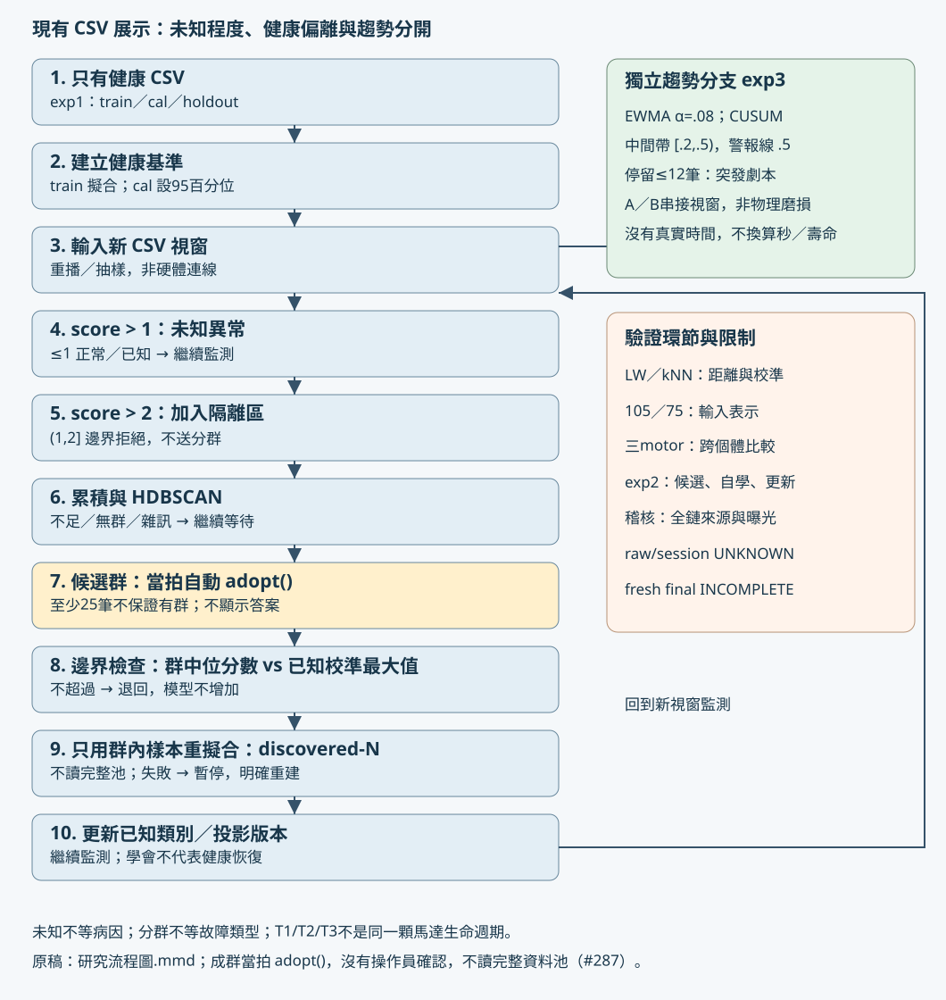

# 研究流程圖

原稿：[Mermaid](exp13_研究流程圖.mmd)。SVG可直接放進報告；圖形代表既有程式，不代表新演算法。來源：src/core/monitor.py、src/core/openset.py、src/experiments/exp2_scale_growth.py、src/experiments/exp3_trend.py、src/web/live.py。

從健康配置切出train/cal/holdout；未知配置未參與健康模型擬合。新視窗超過偵測線1稱為未知，超過隔離線2才累積到隔離區。HDBSCAN找的是特徵群，不是物理病因；資料不足、雜訊或無候選都繼續等待。成群當拍 `adopt()`：群中位分數不超過已知類校準最大值就退回；否則只用這一群到達樣本切分重擬合，類名 discovered-N。沒有操作員確認，也不讀完整配置池（#287）。

實作限制：ScaleGrowthSession._try_cluster目前在後端快取truth的majority/purity供事後對照，但叢集幾何與 `adopt()` 都不使用truth。導覽遮蔽這些欄位，首頁只在事後對照訊息顯示。自由人工標註不是這條展示流程。

趨勢是另一條分支，A／B是CSV視窗拼接劇本。警報以筆數呈現，沒有物理時間、磨損真值或壽命。T1/T2/T3是不同馬達。

| 圖中環節 | 主要驗證實驗 | 可支持與限制 |
|---|---|---|
| 輸入表示 | 105／75、C–M | 舊資料探索，正式105不改 |
| 健康基準與拒絕 | exp1、LW消融、Maha／kNN | 同工況與跨馬達需分開 |
| 更換個體 | 固定方法三motor folds | 弱motor結果見來源索引S7，不支持部署保證 |
| 候選／自學／重擬合 | exp2 | 只用候選群樣本，不是完整資料池oracle |
| 趨勢 | exp3 | 劇本辨別，不是物理退化證明 |
| 全流程來源 | provenance／exposure guards | raw/session仍UNKNOWN；fresh INCOMPLETE |

圖只說明現行操作流程；歷史成績與來源限制由[來源索引](exp13_來源索引.md)查閱。Mermaid與SVG各保留原稿及展示用途。
